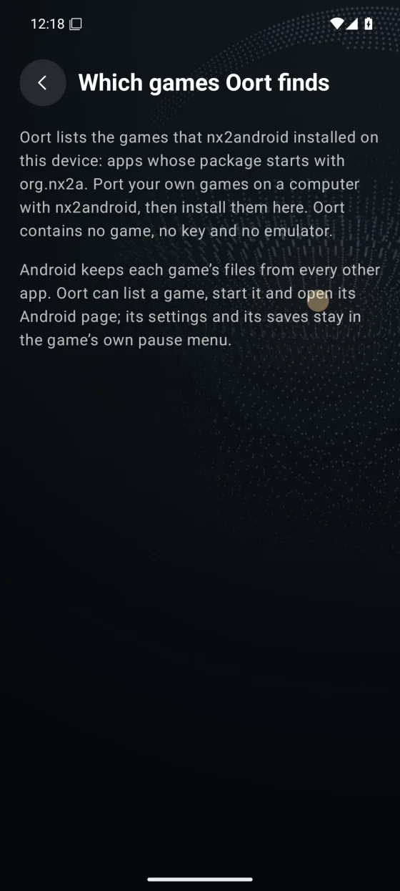
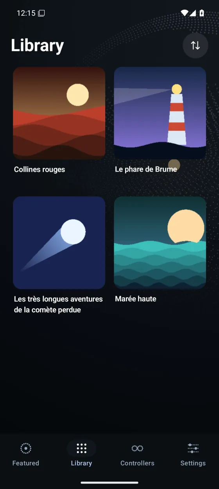

## Make the game’s app
<!-- step port elsewhere https://github.com/shirai91/nx2android -->
On a computer, [nx2android](https://github.com/shirai91/nx2android) turns your own game into an Android app. Oort takes no part, and we have not tried a real game.

## Install the game’s app
<!-- step install code 1aaff5c0:android/app/src/main/kotlin/io/github/sofianbll/oortnx/core/GameScanner.kt 1aaff5c0:android/tools/emulator_check.py -->
Like any APK. Oort keeps the apps whose package starts with `org.nx2a.`.

<!-- missing game-apk: Android while an invented game installs. -->

## Come back to Oort
<!-- step found checked 1aaff5c0:android/tools/emulator_check.py -->
The game appears by itself, with its icon. Otherwise: **Settings › Look again**.

