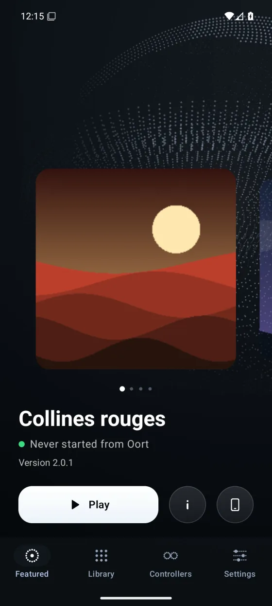
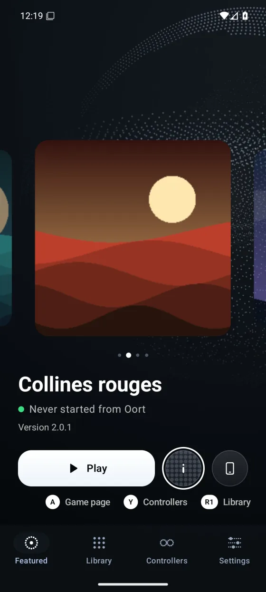
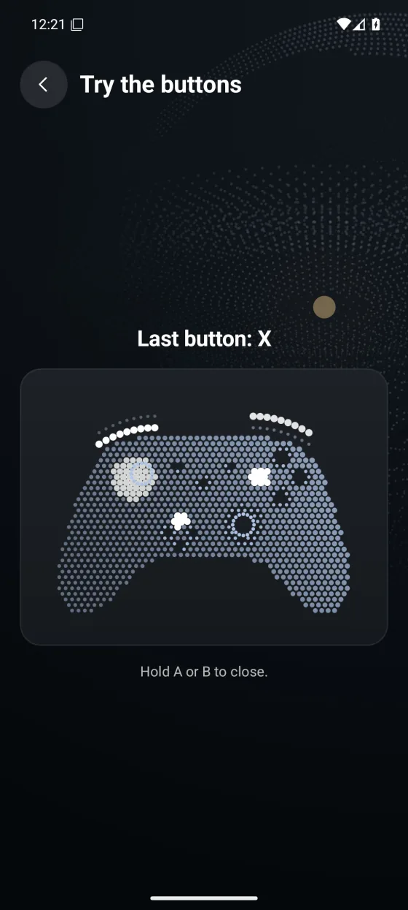
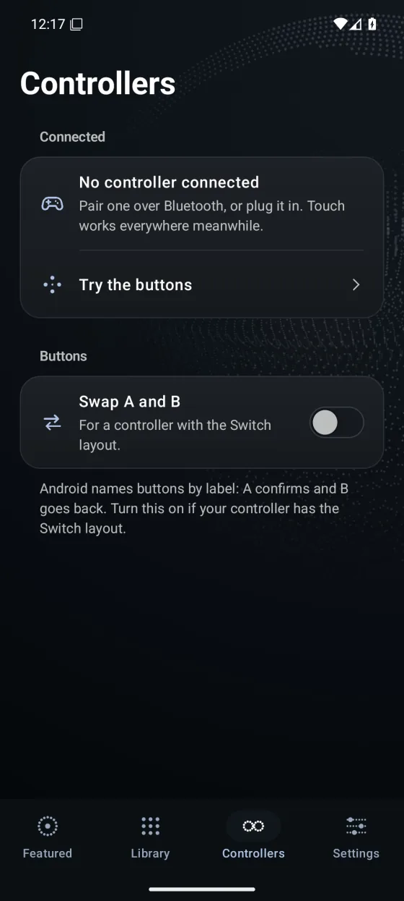

## By touch
<!-- step touch checked 1aaff5c0:android/tools/emulator_check.py -->
Everything works by touch. Every target is at least 48 dp.

## With a controller
<!-- step pad checked 1aaff5c0:android/tools/emulator_check.py 1aaff5c0:android/app/src/main/kotlin/io/github/sofianbll/oortnx/core/PadKeys.kt -->
D-pad or sticks to move. A confirms, B goes back, X sorts or opens the page, Y opens the controllers. Start opens the settings, L1 and R1 change tab.

## Try your buttons
<!-- step test checked 1aaff5c0:android/tools/emulator_check.py 1aaff5c0:android/app/src/main/kotlin/io/github/sofianbll/oortnx/core/PadMonitor.kt -->
**Controllers › Try the buttons**: each button lights up. Hold A or B to close. Checked with a simulated controller, not a real one.

## Swap A and B
<!-- step swap checked 1aaff5c0:android/tools/emulator_check.py 1aaff5c0:android/app/src/main/kotlin/io/github/sofianbll/oortnx/core/Prefs.kt -->
For a controller with the Switch layout: **Controllers › Swap A and B**.

