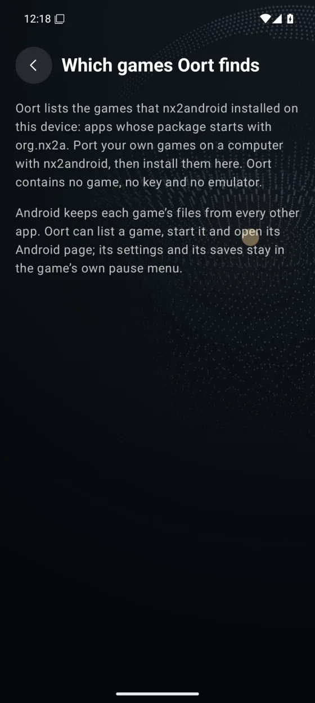
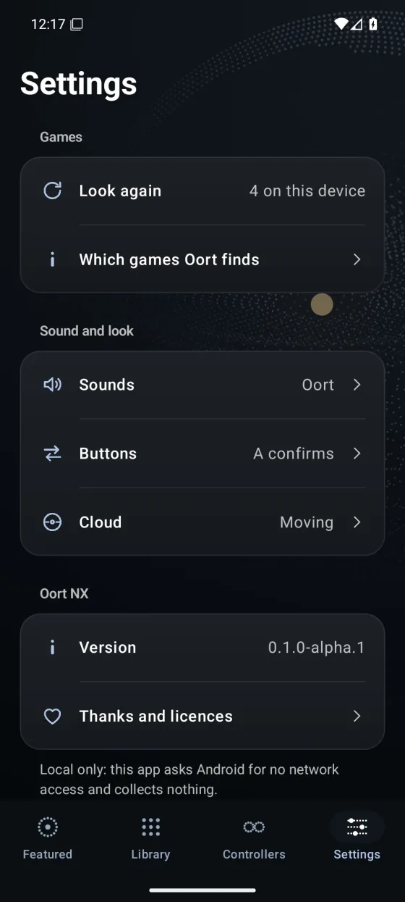

## Reads
<!-- step reads code 1aaff5c0:android/app/src/main/kotlin/io/github/sofianbll/oortnx/core/GameScanner.kt 1aaff5c0:android/app/src/main/AndroidManifest.xml -->
The list of apps Android shows in its own launcher. Oort only keeps those of nx2android games.

## Writes
<!-- step writes code 1aaff5c0:android/app/src/main/kotlin/io/github/sofianbll/oortnx/core/Prefs.kt -->
Its settings and the day each game was last started, inside the app. Nothing in your games.

## Sends
<!-- step sends checked 1aaff5c0:android/app/src/main/AndroidManifest.xml 1aaff5c0:android/tools/emulator_check.py -->
Nothing. The app asks Android for no permission, not even the network.

