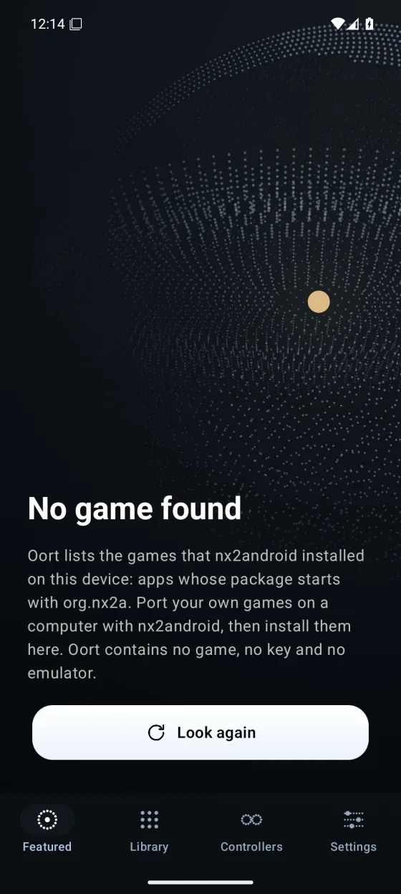
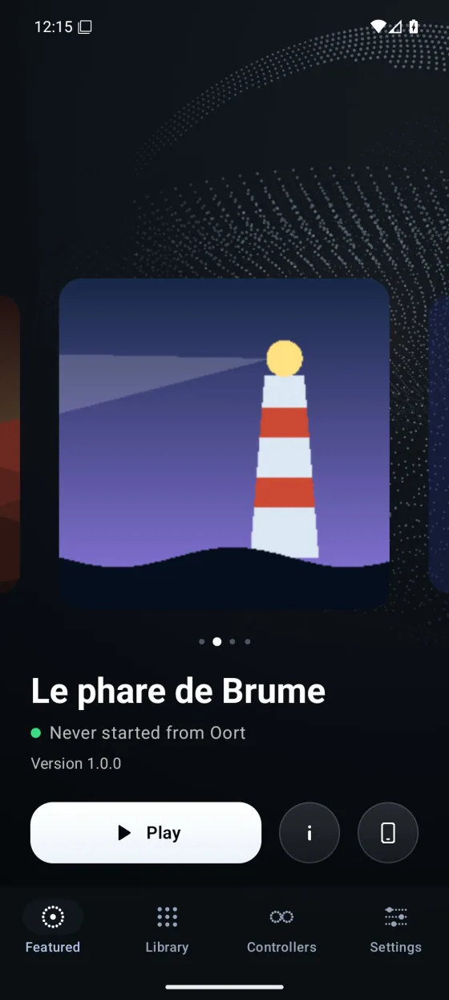
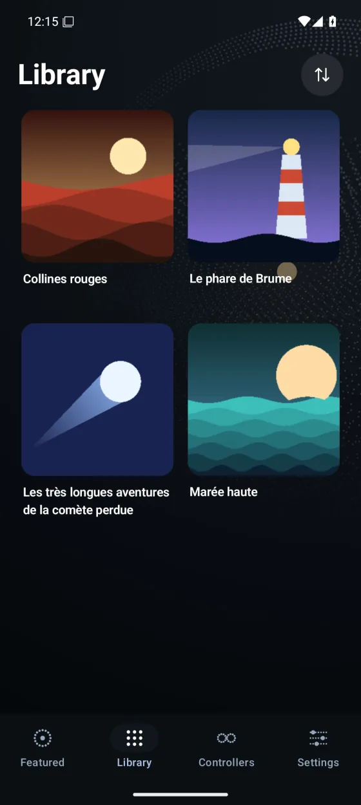

## No game? That is normal
<!-- step empty checked 1aaff5c0:android/tools/emulator_check.py 1aaff5c0:android/app/src/main/res/values/strings.xml -->
Oort contains no game, key or engine. Install an nx2android game, then **Look again**.

## Featured
<!-- step home checked 1aaff5c0:android/tools/emulator_check.py -->
Swipe the large picture to change game. **Play** is under the thumb.

## Four tabs
<!-- step tabs checked 1aaff5c0:android/tools/emulator_check.py -->
Featured, Library, Controllers and Settings. In the library, the button at the top sorts.

