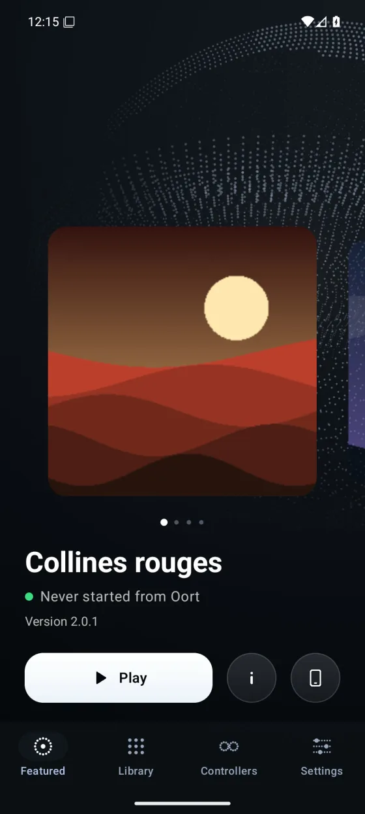

## Download the APK
<!-- step download code 1aaff5c0:android/app/build.gradle.kts https://github.com/sofianbll/oort-nx/releases/tag/android-v0.1.0-alpha.1 -->
Take `Oort-NX-Android-0.1.0-alpha.1.apk` from the [release page](https://github.com/sofianbll/oort-nx/releases/tag/android-v0.1.0-alpha.1), on your device. You need Android 10 or later.

<!-- missing release-page: The release page in the phone’s browser. -->

## Allow your browser
<!-- step allow code 1aaff5c0:android/README.md https://github.com/sofianbll/oort-nx/releases/tag/android-v0.1.0-alpha.1 -->
Android asks whether this source may install apps. Accept for this file, then take the permission back if you like.

<!-- missing unknown-source: Android’s unknown-source request, then Play Protect if it warns. -->

## Good to know: provisional key
<!-- step key code 1aaff5c0:android/README.md https://github.com/sofianbll/oort-nx/releases/tag/android-v0.1.0-alpha.1 -->
This alpha has its own identifier and a provisional key. A final version will install beside it, and the alpha will have to be uninstalled.

## Open Oort NX alpha
<!-- step open checked 1aaff5c0:android/tools/emulator_check.py -->
The app finds by itself the nx2android games already installed.

