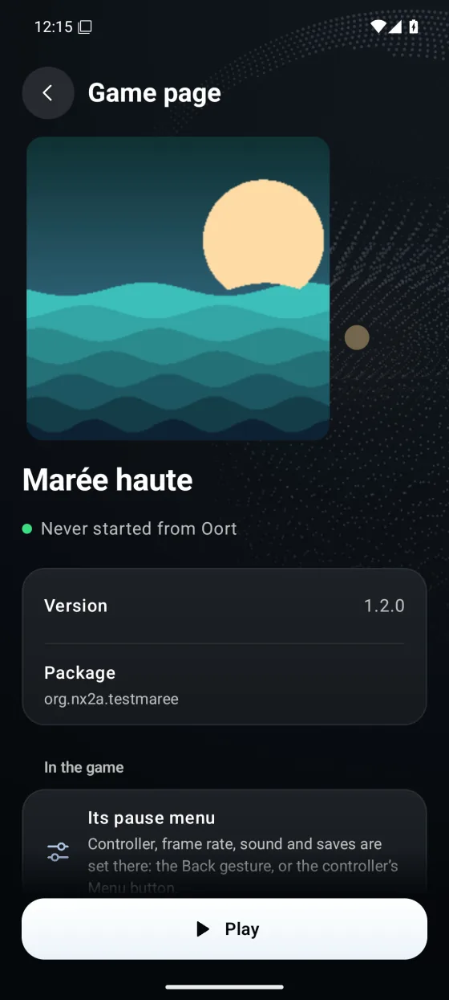
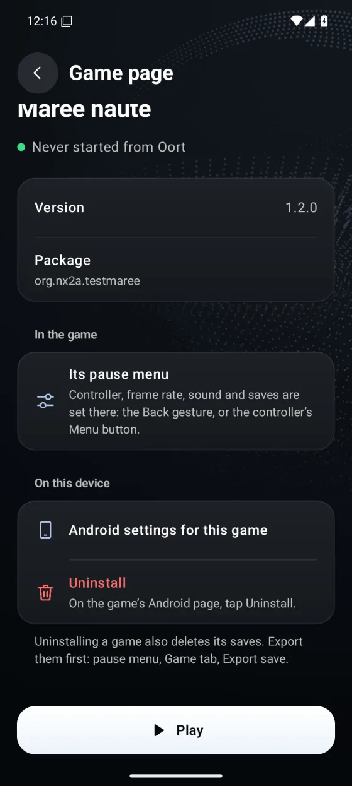

## Start
<!-- step play checked 1aaff5c0:android/tools/emulator_check.py 1aaff5c0:android/app/src/main/kotlin/io/github/sofianbll/oortnx/core/GameLauncher.kt -->
Tap **Play**. Android opens the game’s app.

## While playing
<!-- step in-game code 1aaff5c0:android/app/src/main/res/values/strings.xml 1aaff5c0:android/README.md -->
The Back gesture, or the controller’s Menu button, opens the game’s pause menu. Its settings and saves are there.

## Come back
<!-- step back checked 1aaff5c0:android/tools/emulator_check.py 1aaff5c0:android/app/src/main/kotlin/io/github/sofianbll/oortnx/core/LastStart.kt -->
Quit the game or use the recent apps. Oort notes the day it was started, not the play time.

