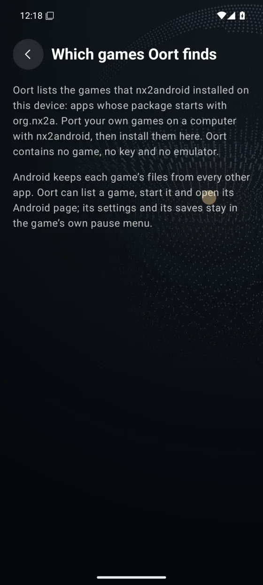
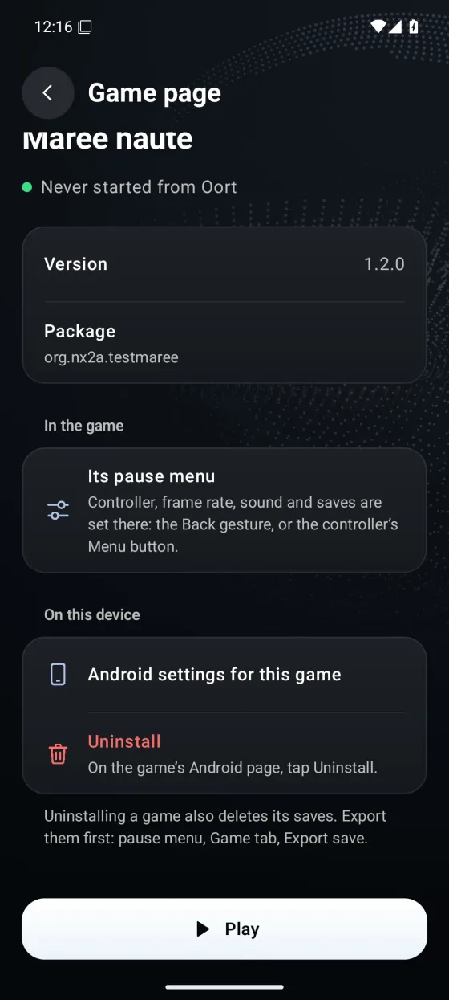

## They stay in the game
<!-- step where code 1aaff5c0:android/README.md 1aaff5c0:android/app/src/main/res/values/strings.xml -->
Android closes a game’s files to other apps. Oort can neither read nor copy them.

## Export before uninstalling
<!-- step export code 1aaff5c0:android/app/src/main/res/values/strings.xml -->
In the game: pause menu, Game tab, Export save. Uninstalling a game deletes its saves. Not tried with a real game.

