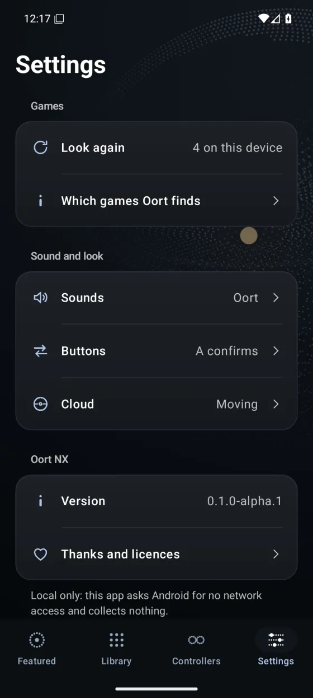
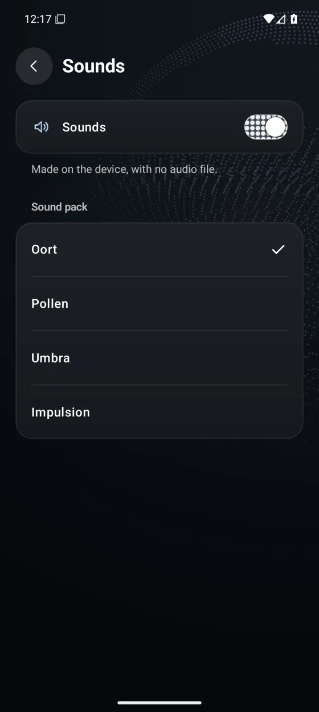
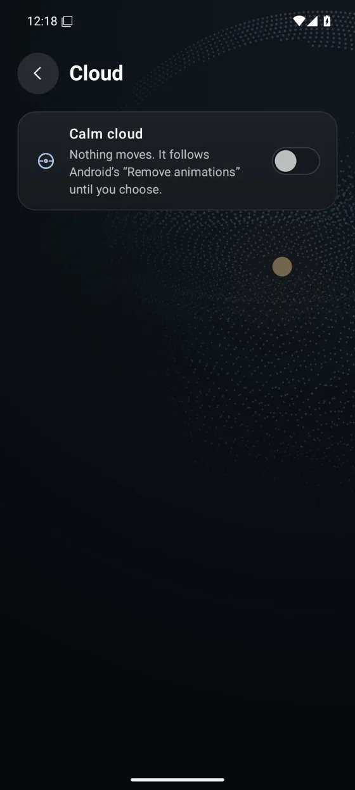
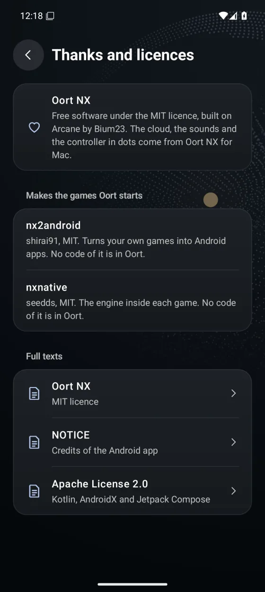

## All on one page
<!-- step all checked 1aaff5c0:android/tools/emulator_check.py 1aaff5c0:android/app/src/main/kotlin/io/github/sofianbll/oortnx/core/Prefs.kt -->
Games, sounds, buttons, cloud and version.

## Sounds
<!-- step sounds checked 1aaff5c0:android/tools/emulator_check.py -->
Turn them off, or choose Oort, Pollen, Umbra or Impulsion. Nobody has listened to them on a real device yet.

## A still cloud
<!-- step calm checked 1aaff5c0:android/tools/emulator_check.py 1aaff5c0:android/app/src/main/kotlin/io/github/sofianbll/oortnx/core/Prefs.kt -->
**Calm cloud** stops all movement. By default it follows Android’s “Remove animations”.

## Language
<!-- step language code 1aaff5c0:android/app/src/main/res/xml/locales.xml -->
French or English, following Android. From Android 13, choose it in Android’s settings for the app.

