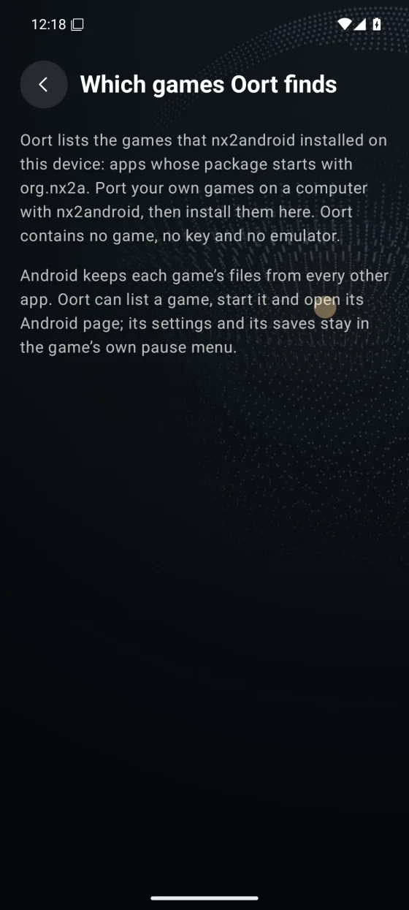
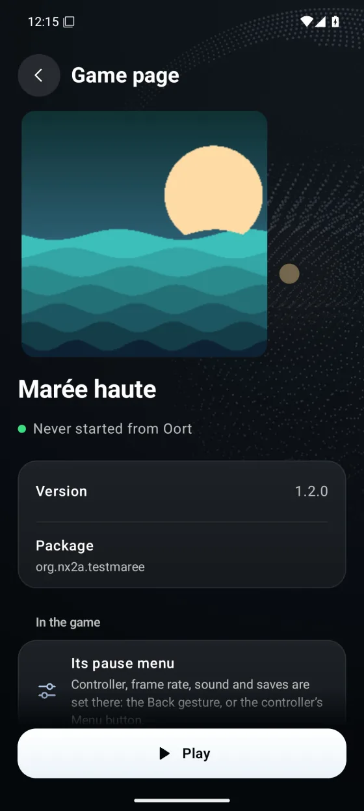
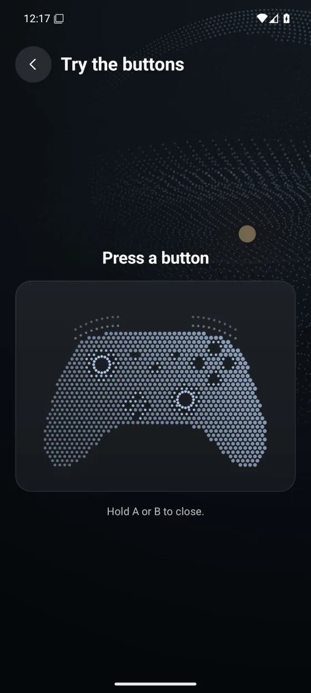
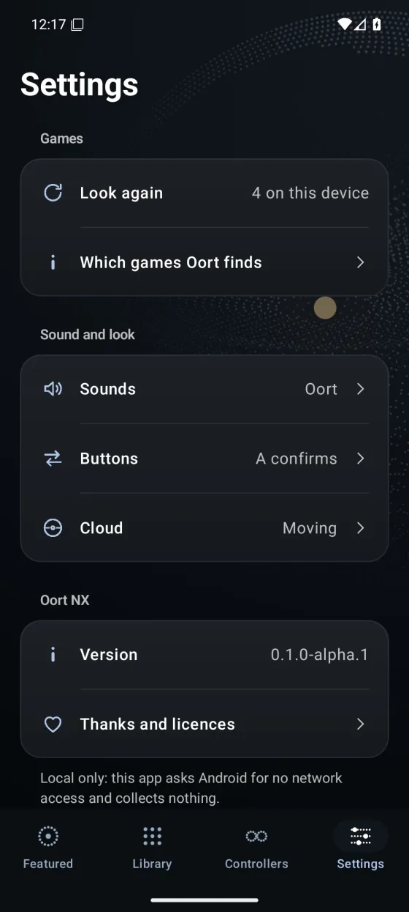

## A game does not show
<!-- step missing checked 1aaff5c0:android/tools/emulator_check.py 1aaff5c0:android/app/src/main/kotlin/io/github/sofianbll/oortnx/core/GameScanner.kt -->
Oort only sees apps whose package starts with `org.nx2a.`. **Settings › Look again**, then check **Which games Oort finds**.

## A game does not start
<!-- step start code 1aaff5c0:android/app/src/main/res/values/strings.xml 1aaff5c0:android/app/src/main/kotlin/io/github/sofianbll/oortnx/core/GameLauncher.kt -->
Start it from Android’s home screen. If it fails there too, the problem is in the game.

## The controller answers badly
<!-- step pad checked 1aaff5c0:android/tools/emulator_check.py -->
Open **Controllers › Try the buttons**. If A and B are swapped, turn on **Swap A and B**.

## Tell us
<!-- step report code 1aaff5c0:SECURITY.md 1aaff5c0:CONTRIBUTING.md -->
[Open a report](https://github.com/sofianbll/oort-nx/issues) with your device, your Android version and Oort’s. No game, key or save.

