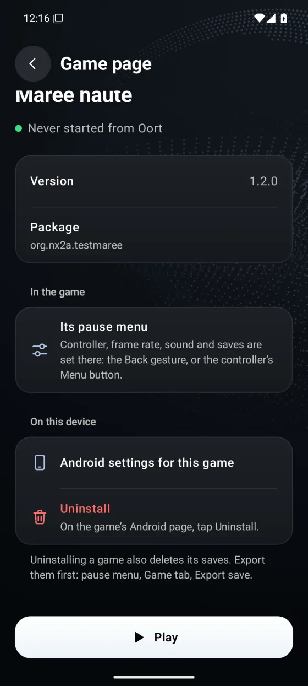

## Remove Oort
<!-- step oort code 1aaff5c0:android/app/src/main/AndroidManifest.xml -->
Long press the icon, then uninstall. Your games stay, only Oort’s settings go.

## Remove a game
<!-- step game code 1aaff5c0:android/app/src/main/kotlin/io/github/sofianbll/oortnx/core/GameLauncher.kt 1aaff5c0:android/app/src/main/res/values/strings.xml -->
On its page, **Uninstall** opens its Android page. Export its save first.

