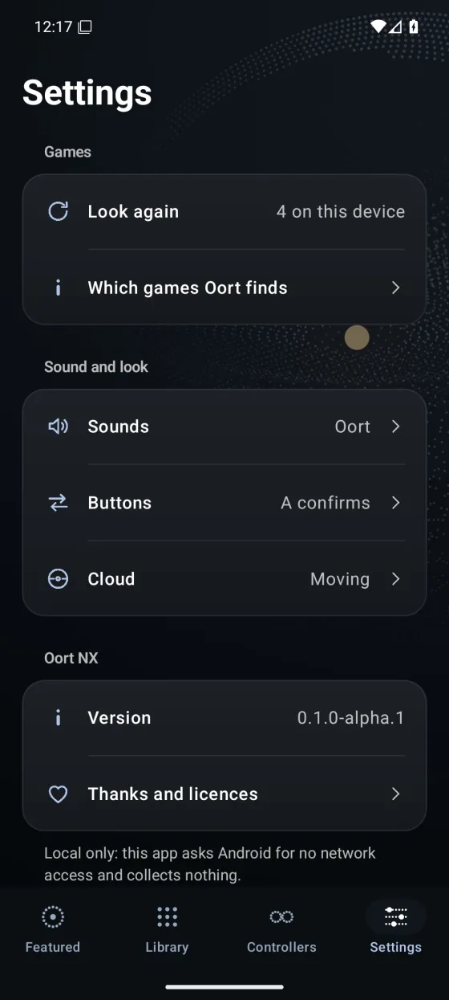

## See your version
<!-- step check code 1aaff5c0:android/README.md 1aaff5c0:android/app/src/main/AndroidManifest.xml -->
It is in **Settings**. The app has no network access: it cannot look for updates.

## Install the new APK
<!-- step over code 1aaff5c0:android/app/build.gradle.kts https://github.com/sofianbll/oort-nx/releases/tag/android-v0.1.0-alpha.1 -->
Take it from the [releases page](https://github.com/sofianbll/oort-nx/releases) and open it over this one. This alpha is the first: no update was tried.

<!-- missing update-apk: Android offering to update the app. -->
