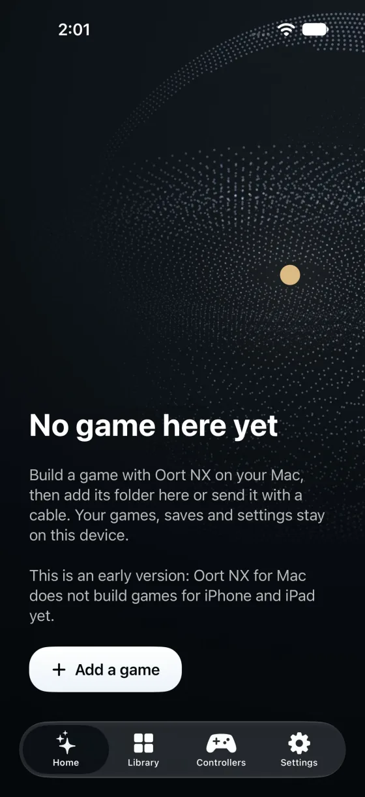
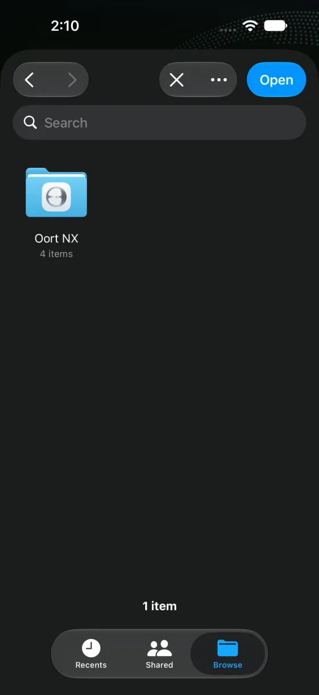
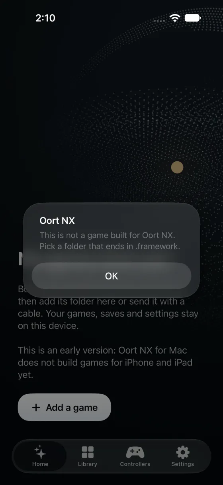

## What it takes
<!-- step know code e3cd6df1:mobile/Sources/OortMobile/Resources/Localizable.xcstrings e3cd6df1:mobile/Sources/OortMobile/FrameworkImport.swift -->
A `DmGame….framework` folder, signed with the same account as the app. Oort for Mac cannot make one yet, and no real game was tried.

## Choose the folder
<!-- step pick checked e3cd6df1:mobile/UITests/OortUITests.swift e3cd6df1:mobile/Sources/OortMobile/FrameworkImport.swift -->
**Add a game**, then the folder in Files. Oort copies it and leaves the original.

## If Oort refuses
<!-- step refused checked e3cd6df1:mobile/UITests/OortUITests.swift -->
It says why: not a game, not enough space or another signature. Nothing has changed.

