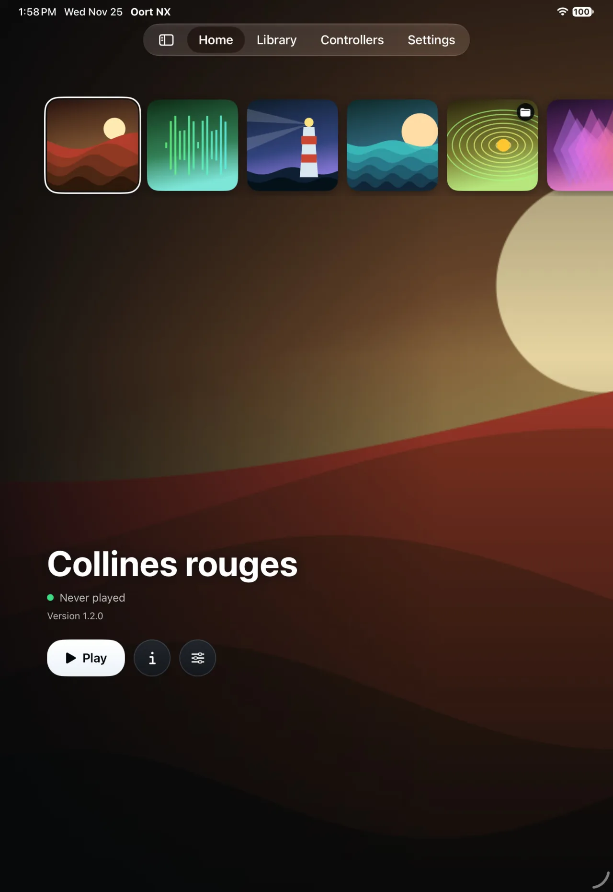
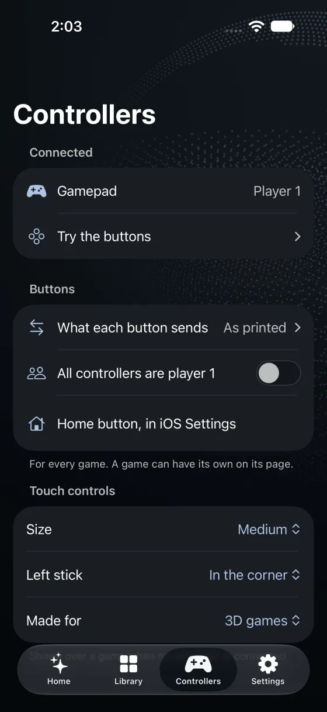
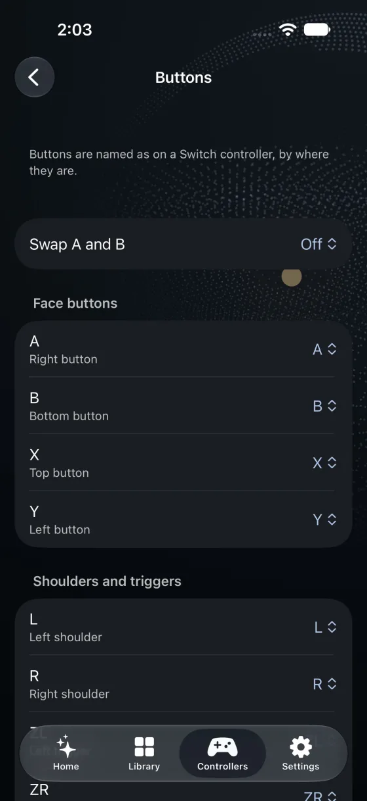

## By touch
<!-- step touch checked e3cd6df1:mobile/UITests/OortUITests.swift -->
Upright, on its side, on iPad, and with very large text.

## With a controller
<!-- step pad checked e3cd6df1:mobile/UITests/OortUITests.swift e3cd6df1:mobile/Sources/OortMobile/OortNav.swift e3cd6df1:mobile/Sources/ShellControllers/PadMapping.swift -->
Pair it in iOS Settings › Bluetooth. A opens, B goes back, L and R change tab. Checked with a simulated controller.

## Change the buttons
<!-- step map checked e3cd6df1:mobile/UITests/OortUITests.swift e3cd6df1:mobile/Sources/OortMobile/ControllersScreen.swift -->
**Controllers › What each button sends**, for every game or on one game’s page. Not tried in a real game.

## Touch controls in a game
<!-- step onscreen code e3cd6df1:mobile/Sources/OortMobile/ControllersScreen.swift https://github.com/sofianbll/oort-nx/releases/tag/ios-v0.1.0-alpha.1 -->
Their settings are there (size, stick, 2D or 3D), but they wait for the engine.

