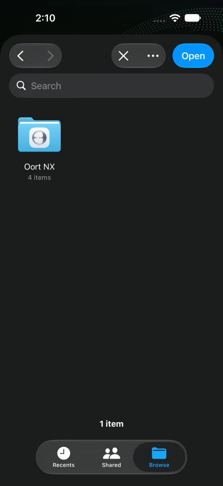
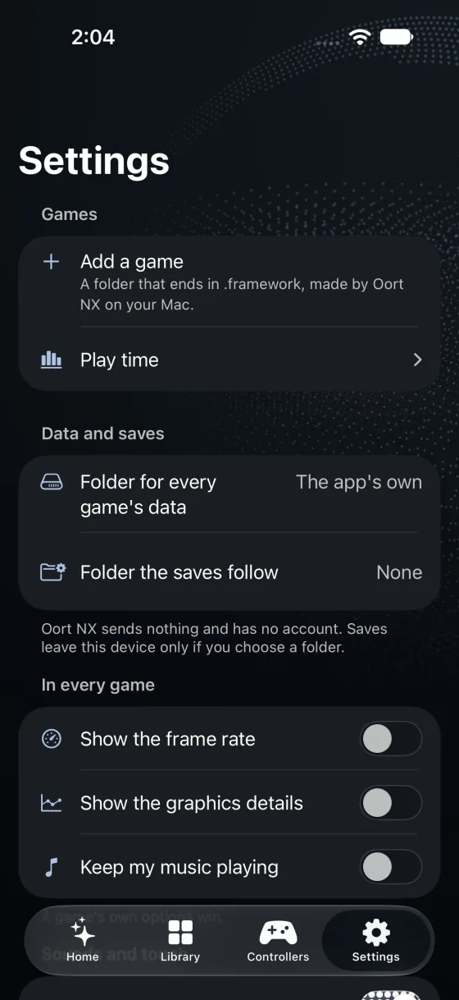

## Reads
<!-- step reads code e3cd6df1:mobile/Sources/OortMobile/FrameworkImport.swift e3cd6df1:mobile/PROVENANCE.md -->
The games you add, and the folders in Files you choose.

## Writes
<!-- step writes code e3cd6df1:mobile/Sources/OortMobile/FrameworkImport.swift e3cd6df1:mobile/Sources/ShellHost/PlayHistoryStore.swift -->
Its own folder, visible in Files: games, saves, settings and play time. Plus the save folder you chose.

## Sends
<!-- step sends code e3cd6df1:mobile/PROVENANCE.md e3cd6df1:mobile/Sources/OortMobile/Resources/Localizable.xcstrings -->
Nothing: no network request, no account. The tool that signs the app does talk to Apple with your account.

