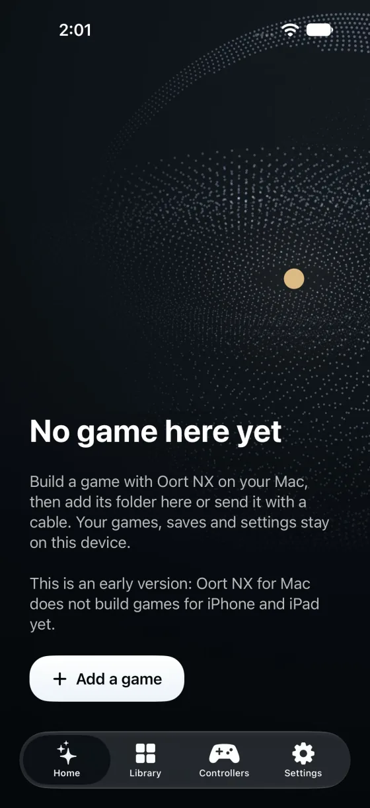
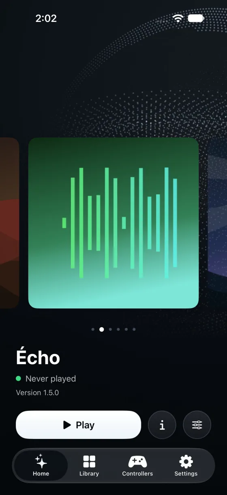
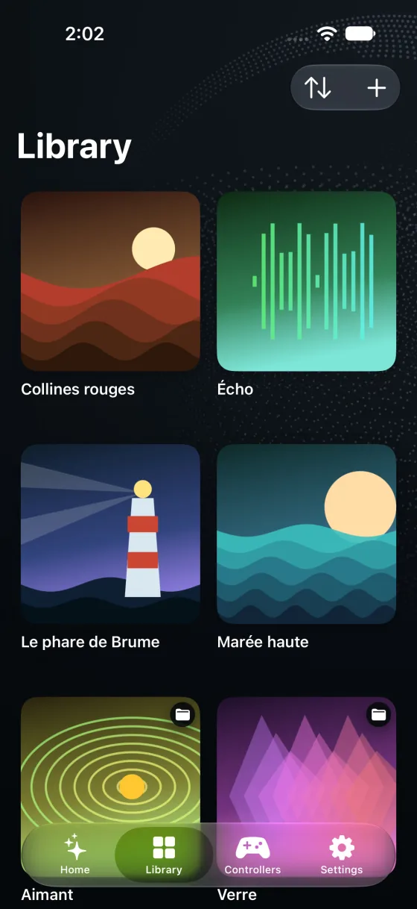

## An empty library
<!-- step empty checked e3cd6df1:mobile/UITests/OortUITests.swift e3cd6df1:mobile/Sources/OortMobile/Resources/Localizable.xcstrings -->
The app contains no game, and says so. **Add a game** opens Files.

## Home
<!-- step home checked e3cd6df1:mobile/UITests/OortUITests.swift -->
Swipe the large picture. **Play** is below, with the game page and options beside it.

## The library
<!-- step tabs checked e3cd6df1:mobile/UITests/OortUITests.swift e3cd6df1:mobile/Sources/OortMobile/LibraryView.swift -->
Search at the top, sort by last played or by name, and add with **+**.

