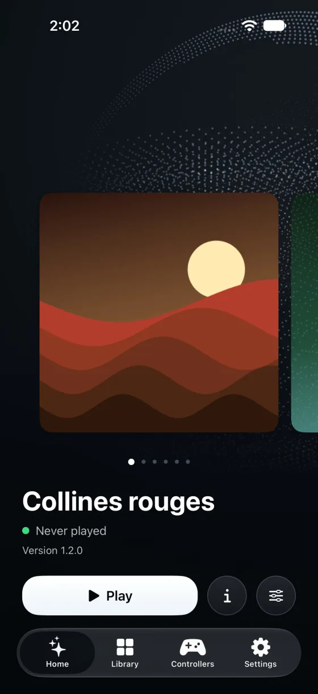

## Read first
<!-- step risk elsewhere https://sideinstaller.net https://altload.org -->
[SideInstaller](https://sideinstaller.net) and [AltLoad](https://altload.org) have you run a command that downloads a program, then type your Apple password. Use a secondary account, and only their official sites.

<!-- missing official-site: The official page, address visible. -->

## Install the free apps
<!-- step apps elsewhere https://sideinstaller.net/install.html https://altload.org/apple-id.html -->
SideInstaller asks for **LocalDevVPN** and **Open Minis**; AltLoad adds **rootshell**. They are on the App Store. You also need Wi-Fi and Developer Mode.

<!-- missing alone-apps: The apps on the Home Screen. -->

## With SideInstaller
<!-- step side elsewhere https://sideinstaller.net/install.html -->
Follow its [install page](https://sideinstaller.net/install.html). Then choose **Custom .ipa** and give it the Oort NX file, or SideStore first.

<!-- missing sideinstaller: SideInstaller, Custom .ipa choice. -->

## Or with AltLoad
<!-- step alt elsewhere https://altload.org/apple-id.html -->
Follow [Apple ID Install](https://altload.org/apple-id.html), not Direct Install: that one uses a shared certificate and a DNS profile, and may stop without notice.

<!-- missing altload: AltLoad, steps ticked. -->

## iOS 26
<!-- step older elsewhere https://sideinstaller.net -->
It needs a pairing file made once on a computer: use the [iloader guide](install-iloader.md) instead.

