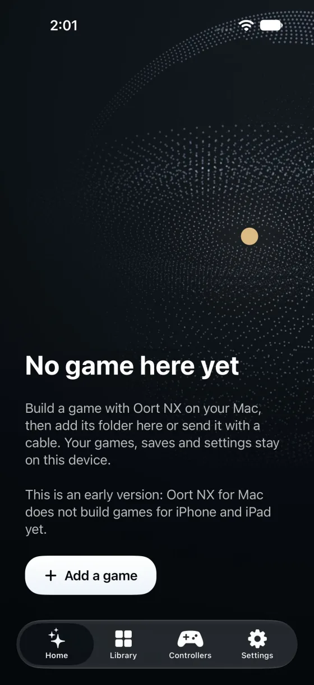

## Prepare the iPhone
<!-- step vpn elsewhere https://docs.sidestore.io/docs/installation/prerequisites -->
It needs a passcode and Wi-Fi. Install **LocalDevVPN** from the App Store and connect it: [SideStore preparation](https://docs.sidestore.io/docs/installation/prerequisites).

<!-- missing localdevvpn: LocalDevVPN connected. -->

## Install iloader
<!-- step iloader elsewhere https://iloader.app -->
Take it only from [iloader.app](https://iloader.app) or its GitHub repository. Windows needs iTunes; Linux needs usbmuxd.

<!-- missing iloader: The iloader window. -->

## Install SideStore
<!-- step sidestore elsewhere https://docs.sidestore.io/docs/installation/install -->
Plug in the iPhone, open iloader and sign in with the secondary account. Choose the device, then **Install SideStore (Stable)**.

<!-- missing iloader-install: iloader, device selected. -->

## Trust it
<!-- step trust elsewhere https://docs.sidestore.io/docs/installation/install -->
On the iPhone: **Settings › General › VPN & Device Management**, your account, then **Trust**. Then **Privacy & Security › Developer Mode**: the device restarts.

<!-- missing trust: The two iOS Settings pages. -->

## Finish SideStore
<!-- step refresh elsewhere https://docs.sidestore.io/docs/installation/install -->
Connect LocalDevVPN, open SideStore with the same account, then in **My Apps** tap **7 DAYS** a first time.

<!-- missing sidestore: SideStore, My Apps tab. -->

## Add Oort NX
<!-- step oort elsewhere https://github.com/sofianbll/oort-nx/releases/tag/ios-v0.1.0-alpha.1 https://docs.sidestore.io/docs/faq -->
Download `Oort-NX-iOS-0.1.0-alpha.1-unsigned.ipa` from the [release page](https://github.com/sofianbll/oort-nx/releases/tag/ios-v0.1.0-alpha.1) and add it in SideStore. It takes one of a free account’s three places.

<!-- missing sidestore-ipa: SideStore while the IPA is added. -->

## Open Oort NX
<!-- step open checked e3cd6df1:mobile/UITests/OortUITests.swift -->
The first page says there is no game yet. That is normal.

