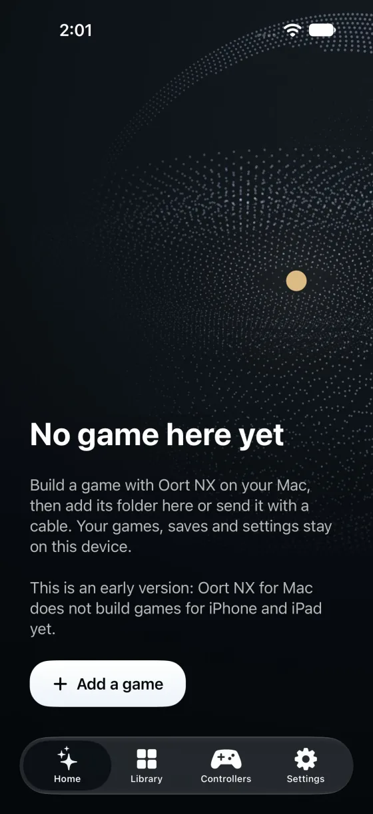
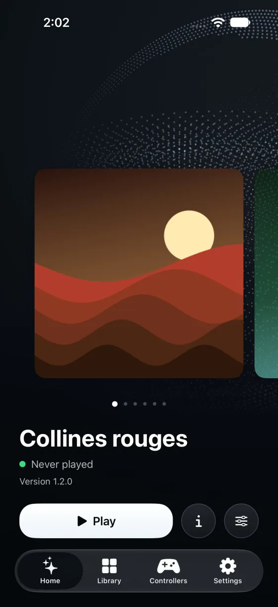

## First: to look at, not to play yet
<!-- step know code e3cd6df1:mobile/App/project.yml e3cd6df1:mobile/Sources/OortMobile/Resources/Localizable.xcstrings https://github.com/sofianbll/oort-nx/releases/tag/ios-v0.1.0-alpha.1 -->
This alpha contains no game, and Oort for Mac does not make any for iPhone yet. You need iOS or iPadOS 26 or later.

## Use a secondary Apple account
<!-- step account elsewhere https://docs.sidestore.io/docs/faq https://iloader.app -->
The app is not signed: you sign it with an Apple account, typed into a tool that is not Apple’s. Our advice is an account made for this. A free account signs for 7 days, and 3 apps at a time.

<!-- missing apple-account: Signing in inside the tool, with an invented account. -->

## Choose
<!-- step choose elsewhere https://docs.sidestore.io/docs/installation/prerequisites https://iloader.app https://sideinstaller.net https://altload.org -->
A Windows, Linux or Mac computer at hand: [iloader guide](install-iloader.md). No computer, and iOS 27 or later: [guide without a computer](install-alone.md).

