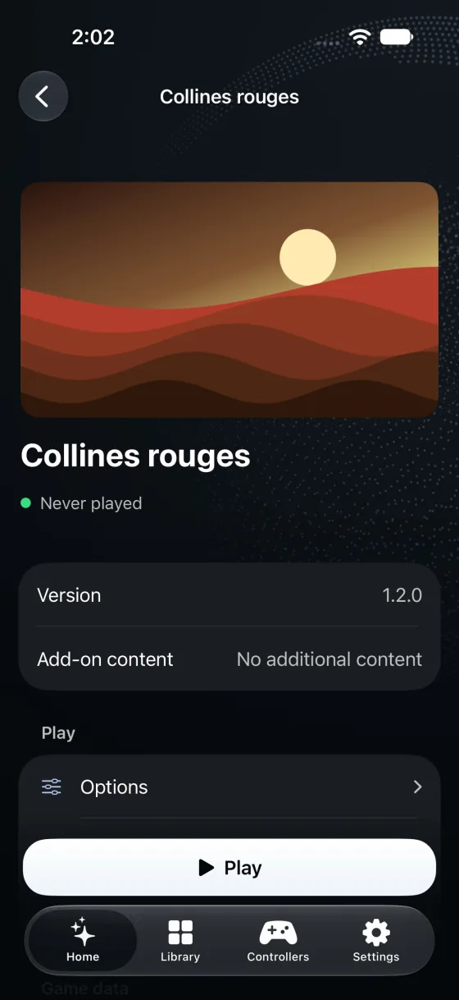
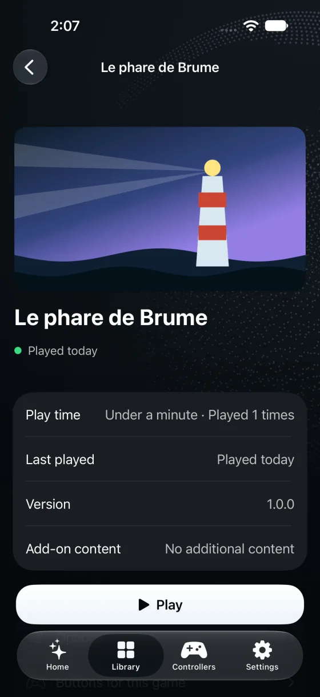

## Start
<!-- step play checked e3cd6df1:mobile/UITests/OortUITests.swift -->
Tap **Play** on the game page.

## While playing
<!-- step in-game checked e3cd6df1:mobile/UITests/OortUITests.swift -->
Checked with an invented game only. Coming back from a real game waits for the engine.

## Come back
<!-- step back checked e3cd6df1:mobile/UITests/OortUITests.swift e3cd6df1:mobile/Sources/OortMobile/SettingsScreens.swift -->
Play time is counted on this device, in **Settings › Play time**.

