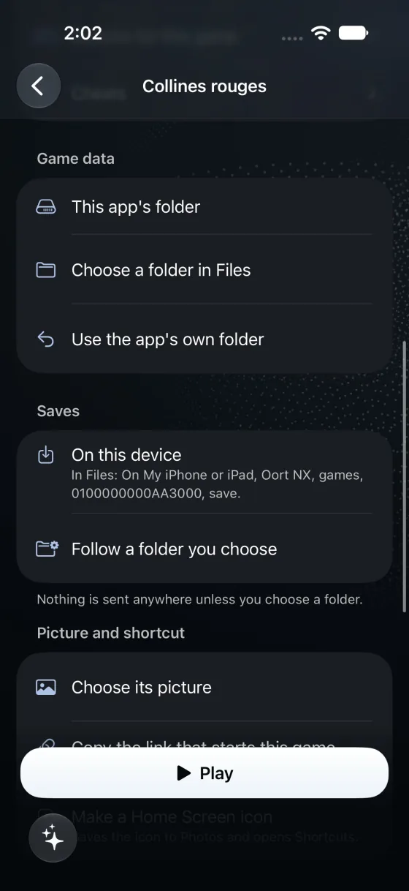
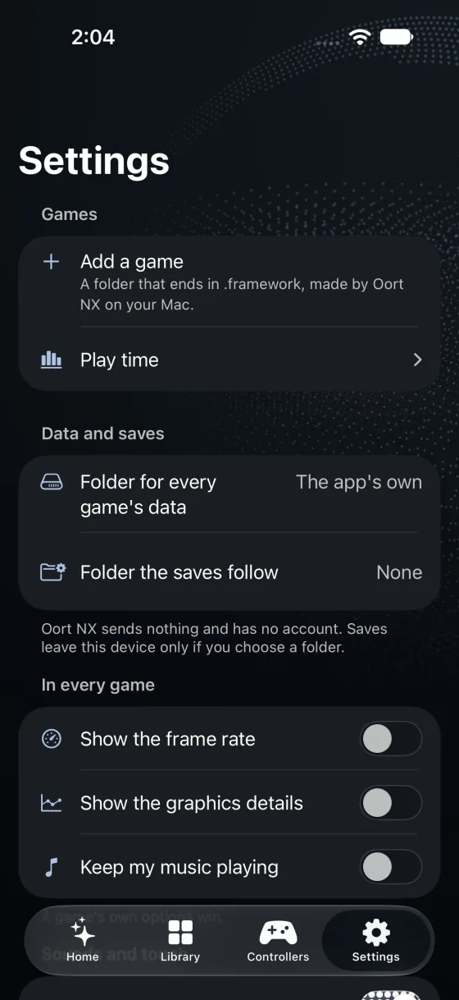

## Where they are
<!-- step where code e3cd6df1:mobile/Sources/OortMobile/GameScreens.swift -->
In Files: On My iPhone, Oort NX, `games`, the game, `save`.

## Follow a folder
<!-- step follow code e3cd6df1:mobile/Sources/OortMobile/GameScreens.swift e3cd6df1:mobile/Sources/ShellHost/CloudSaveSyncCheck.swift -->
You may choose a folder in Files for saves to follow, iCloud Drive for example. Nothing leaves otherwise. Not tried for real.

## Before removing a game
<!-- step copy code e3cd6df1:mobile/Sources/OortMobile/Resources/Localizable.xcstrings -->
Choose **Remove the game, keep its saves**. A deleted save cannot come back.

