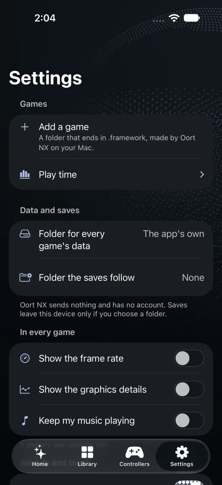
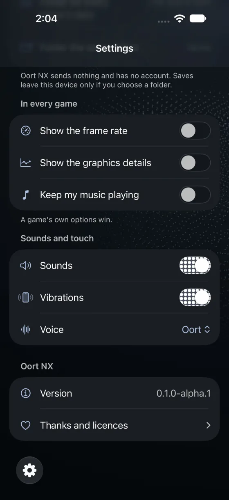
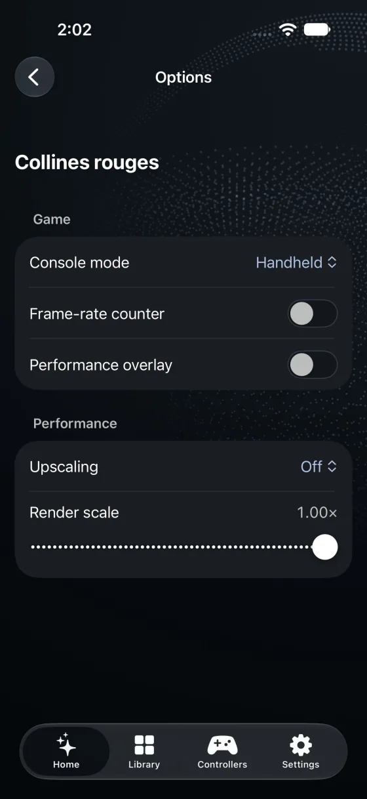

## The Settings page
<!-- step all checked e3cd6df1:mobile/UITests/OortUITests.swift e3cd6df1:mobile/Sources/OortMobile/SettingsScreens.swift -->
Add a game, play time, folders, options shared by every game.

## Sounds and touch
<!-- step sounds checked e3cd6df1:mobile/UITests/OortUITests.swift e3cd6df1:mobile/Sources/OortMobile/SettingsScreens.swift -->
Turn them off or change the voice. Not listened to on a real device.

## A game’s options
<!-- step game checked e3cd6df1:mobile/UITests/OortUITests.swift e3cd6df1:mobile/Sources/OortMobile/GameScreens.swift -->
They come from the game itself, and win over the shared settings.

