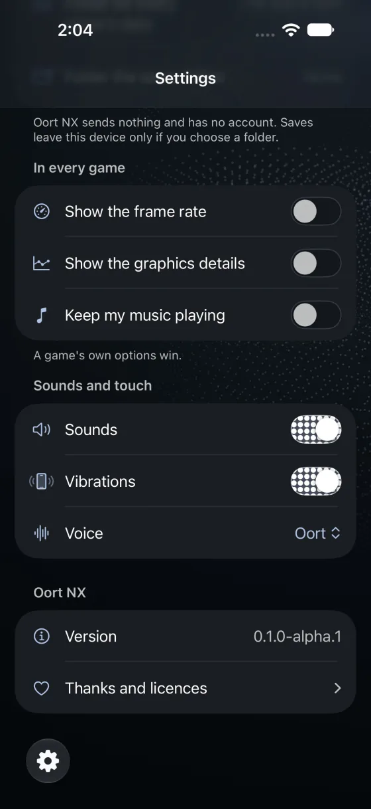
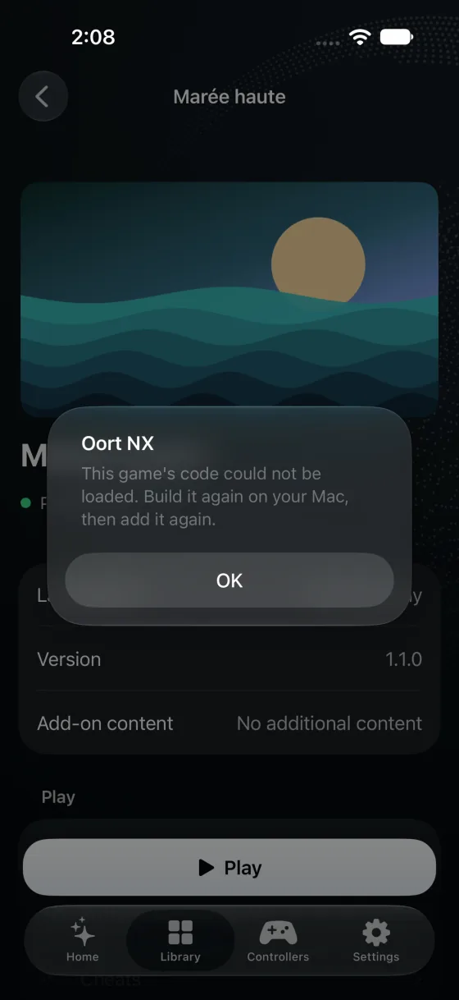
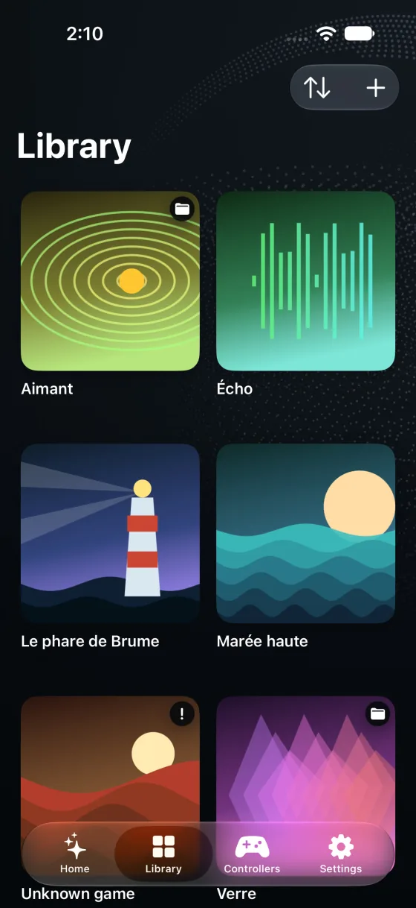

## The app no longer opens
<!-- step expired code e3cd6df1:mobile/Sources/OortMobile/SettingsScreens.swift e3cd6df1:mobile/Sources/ShellHost/ProvisioningProfile.swift -->
Its signature has probably expired. Refresh it with the same account; your games and saves should stay. Not tried.

## The game’s code is refused
<!-- step code checked e3cd6df1:mobile/UITests/OortUITests.swift -->
It is not signed like the app, or it is damaged.

## A game has an exclamation mark
<!-- step damaged checked e3cd6df1:mobile/UITests/OortUITests.swift -->
Its page says what is missing. Add it again.

## Tell us
<!-- step report code e3cd6df1:SECURITY.md e3cd6df1:CONTRIBUTING.md -->
[Open a report](https://github.com/sofianbll/oort-nx/issues) with your device, your iOS version and Oort’s. No game, key or save.

