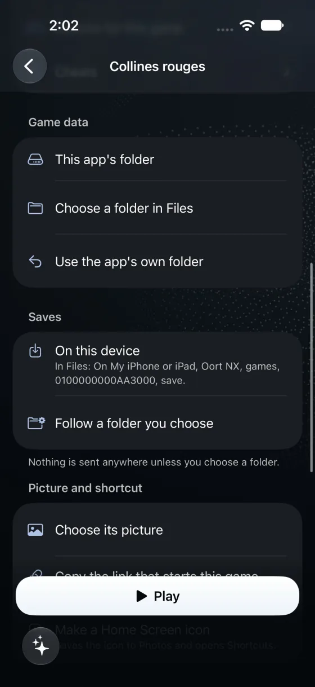
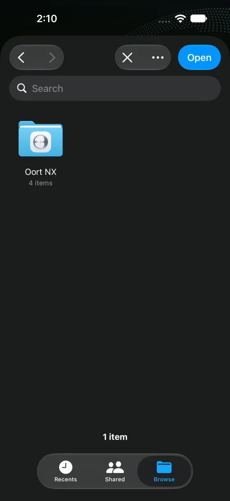

## Remove a game
<!-- step game code e3cd6df1:mobile/Sources/OortMobile/GameScreens.swift e3cd6df1:mobile/Sources/OortMobile/Resources/Localizable.xcstrings -->
On its page, **Remove from this device**, with or without its saves.

## Remove the app
<!-- step app code e3cd6df1:mobile/App/project.yml e3cd6df1:mobile/Sources/OortMobile/FrameworkImport.swift -->
iOS deletes its games and saves with it. First copy the Oort NX folder from Files.

