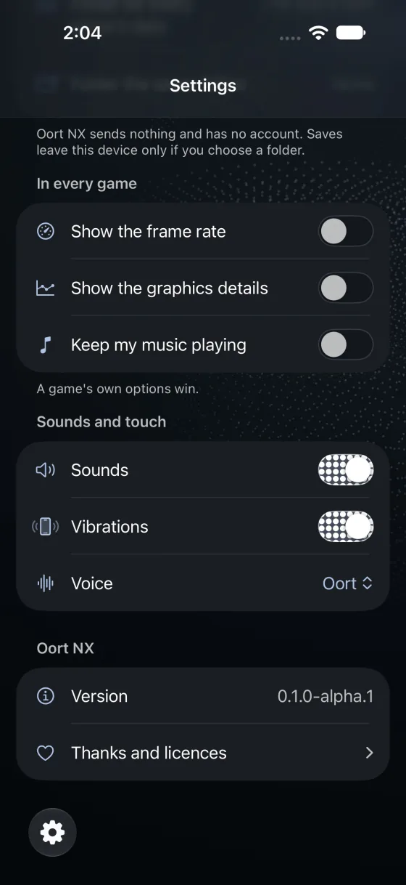

## Every 7 days
<!-- step refresh elsewhere https://docs.sidestore.io/docs/installation/install https://docs.sidestore.io/docs/faq -->
With a free account, refresh Oort NX in SideStore, with LocalDevVPN connected. Oort warns when its signature is about to end.

<!-- missing sidestore-refresh: SideStore, day counter. -->

## New version
<!-- step update code e3cd6df1:mobile/Sources/OortMobile/Resources/Localizable.xcstrings https://github.com/sofianbll/oort-nx/releases/tag/ios-v0.1.0-alpha.1 -->
Add the new IPA with the same tool and the same account, without deleting the old app. This alpha is the first: no update was tried.

