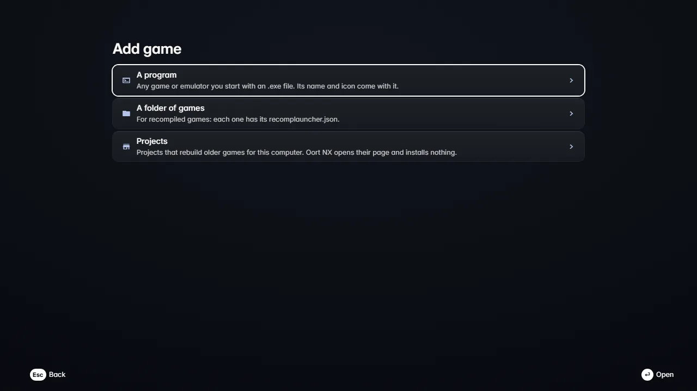
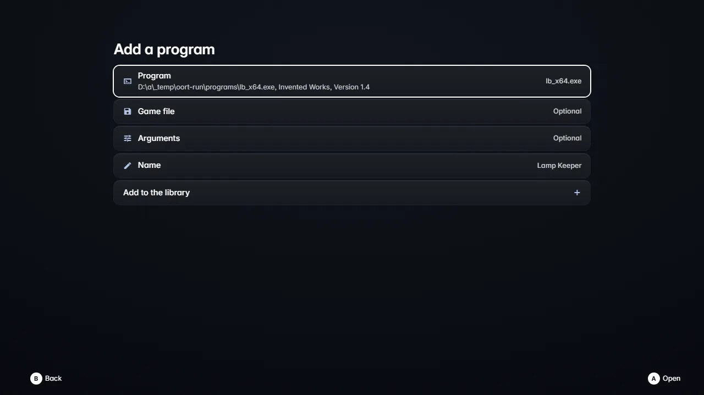
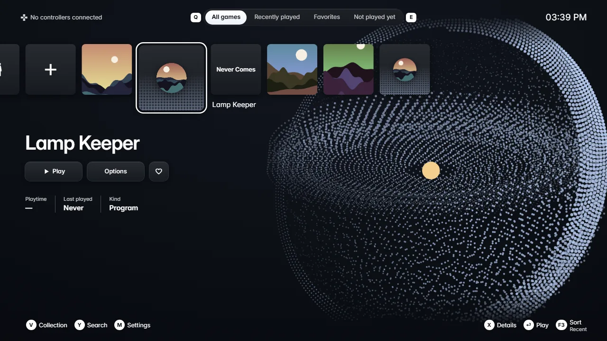

## Open Add game
<!-- step add checked f18e2119:desktop/ui/app.js -->
Choose the **+** tile, then **A program**.

## Choose the file
<!-- step program code f18e2119:desktop/ui/app.js f18e2119:Sources/OortCompanion/ProgramFile.swift -->
**Program** is the file to start, or its menu entry. For an emulator, **Game file** is the game it must open.

## Add it
<!-- step finish code f18e2119:desktop/ui/app.js f18e2119:Sources/OortCompanion/Companion+Own.swift -->
Its name and icon come by themselves, read in its file. Change the name if you like, then **Add to the library**.

