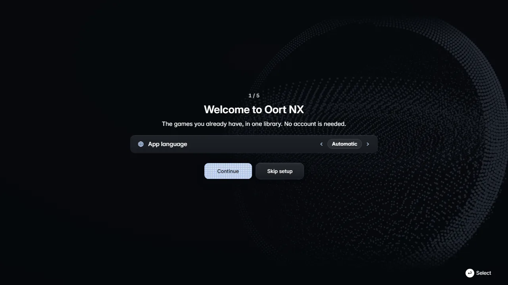
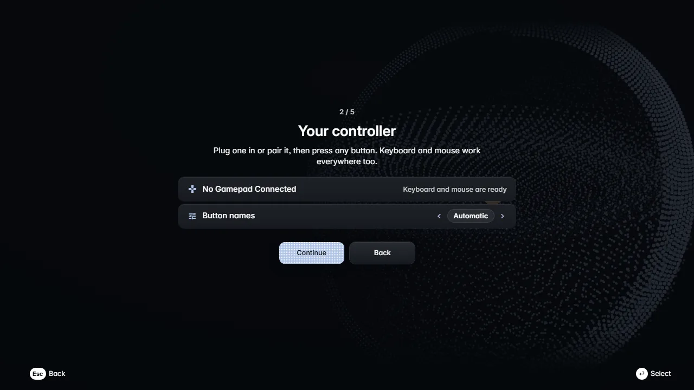
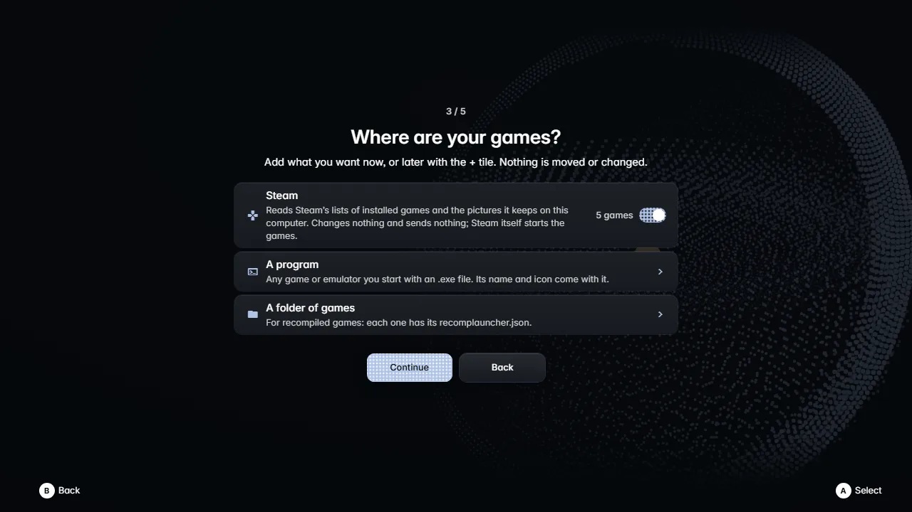
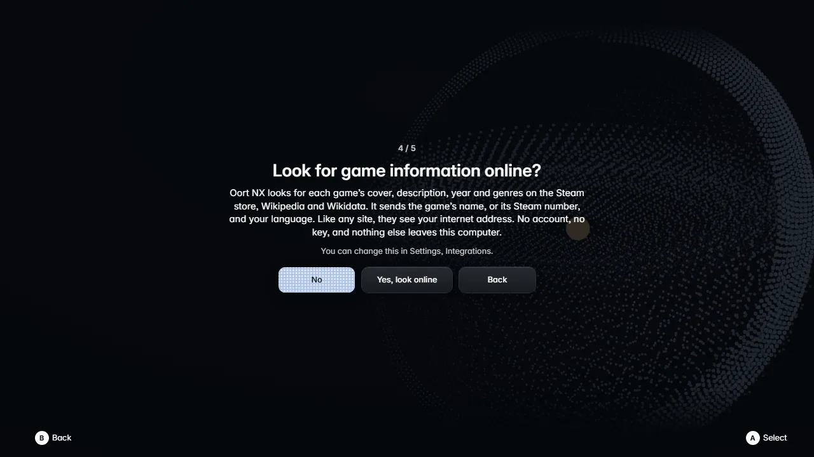
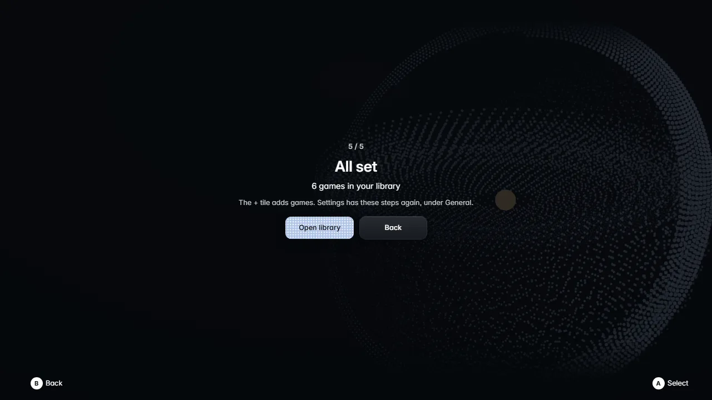
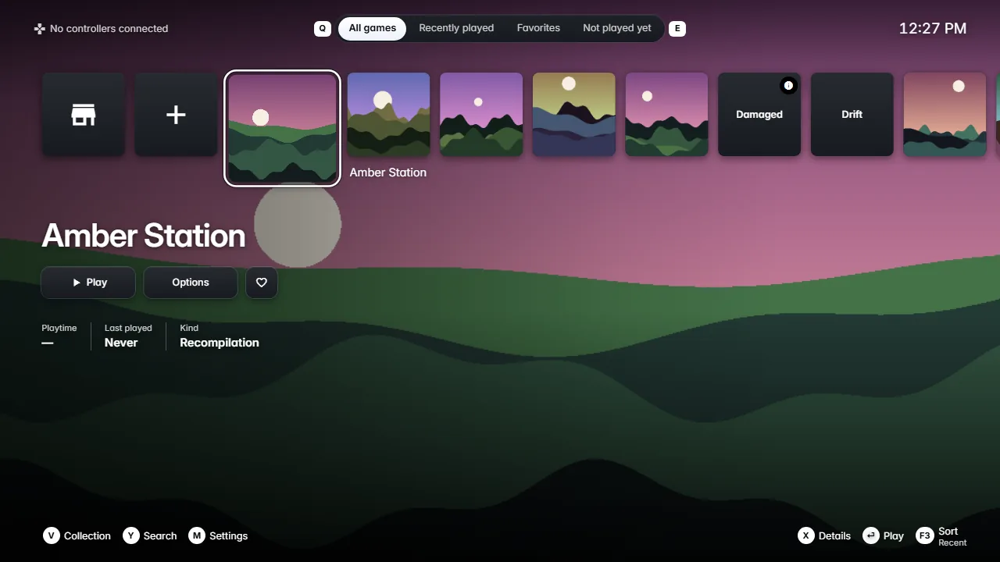

## Skip or follow the setup
<!-- step welcome checked f18e2119:desktop/ui/app.js f18e2119:desktop/tests/linux/prove.sh -->
The guided setup opens: five short pages, with a controller or the keyboard. Choose your language, then **Continue**. **Skip setup** closes it.

## Try your controller
<!-- step controller checked f18e2119:desktop/ui/app.js f18e2119:desktop/tests/linux/prove.sh -->
Plug it in and press a button: its name shows. Without one, go on with the keyboard or the mouse.

## Say where your games are
<!-- step games checked f18e2119:desktop/ui/app.js f18e2119:desktop/tests/linux/prove.sh -->
Steam, a program, a folder of recompiled games: add what you want. Nothing is moved or changed, and the **+** tile does the same later.

## Answer about information online
<!-- step online checked f18e2119:desktop/ui/app.js f18e2119:desktop/tests/linux/prove.sh -->
Oort asks whether it may look for covers and descriptions. **No** is the starting choice, and nothing is sent before you answer.

## Open your library
<!-- step done checked f18e2119:desktop/ui/app.js f18e2119:desktop/tests/linux/prove.sh -->
**Open the library**. The setup opens again from **Settings › General › Guided setup**, and erases nothing.

## Find your games
<!-- step home checked f18e2119:desktop/ui/app.js f18e2119:desktop/tests/walk.js -->
Each game is a tile. The first two tiles open **Projects** and **Add game**.

