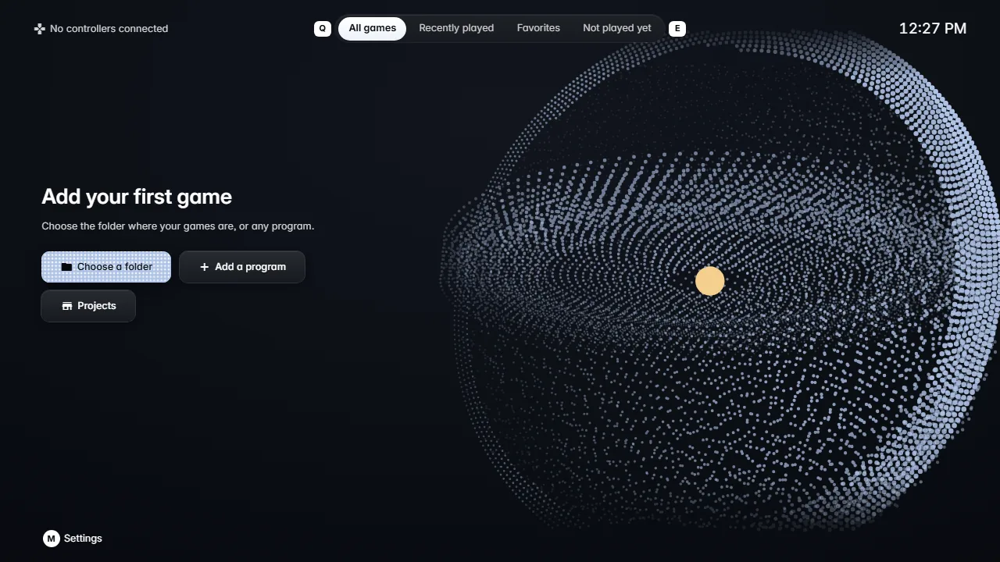

## Download
<!-- step download code cc9db84a:desktop/src-tauri/tauri.conf.json https://github.com/sofianbll/oort-nx/releases/tag/windows-v0.1.0-alpha.1 -->
Take `Oort-NX-Linux-0.1.0-alpha.1-x64.deb` and `SHA256SUMS` from the [release page](https://github.com/sofianbll/oort-nx/releases/tag/windows-v0.1.0-alpha.1). You need a 64-bit Linux that reads .deb packages; only Ubuntu 24.04 was tried.

<!-- missing release-page: The release page on GitHub, files unfolded. -->

## Compare the checksum
<!-- step checksum code cc9db84a:desktop/tests/linux/prove.sh https://github.com/sofianbll/oort-nx/releases/tag/windows-v0.1.0-alpha.1 -->
In the download folder, `sha256sum -c SHA256SUMS --ignore-missing` must answer OK. Otherwise, delete the file.

<!-- missing checksum: The terminal with the checksum and its answer. -->

## Install the package
<!-- step run checked cc9db84a:desktop/tests/linux/prove.sh -->
In the download folder: `sudo apt install ./Oort-NX-Linux-0.1.0-alpha.1-x64.deb`. The libraries it needs come with it.

<!-- missing apt-install: The terminal while the .deb installs. -->

## Open Oort NX
<!-- step open checked cc9db84a:desktop/tests/linux/prove.sh -->
It is in the applications menu. The first page asks where your games are.

