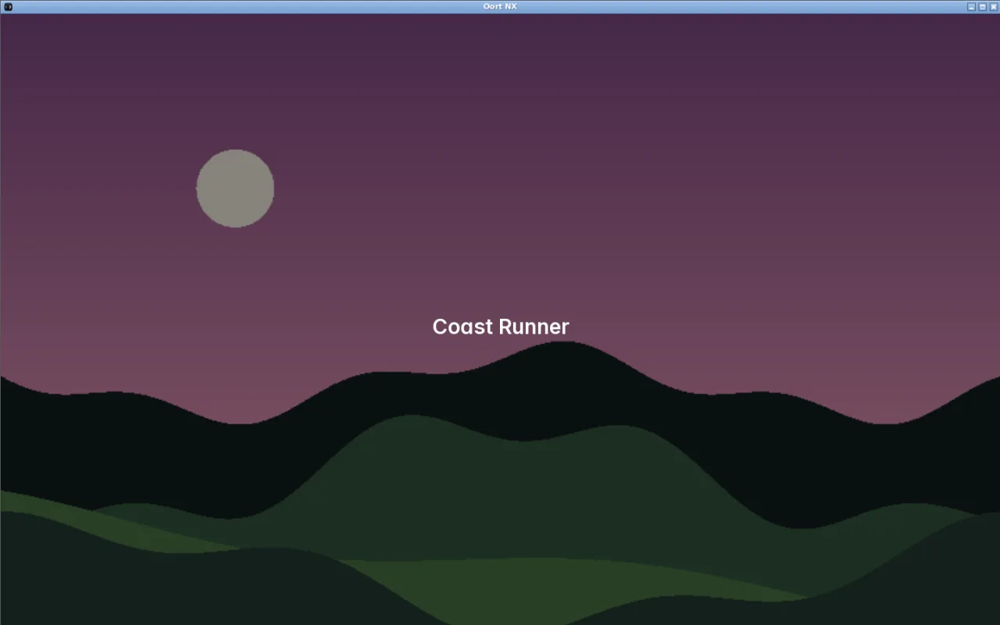
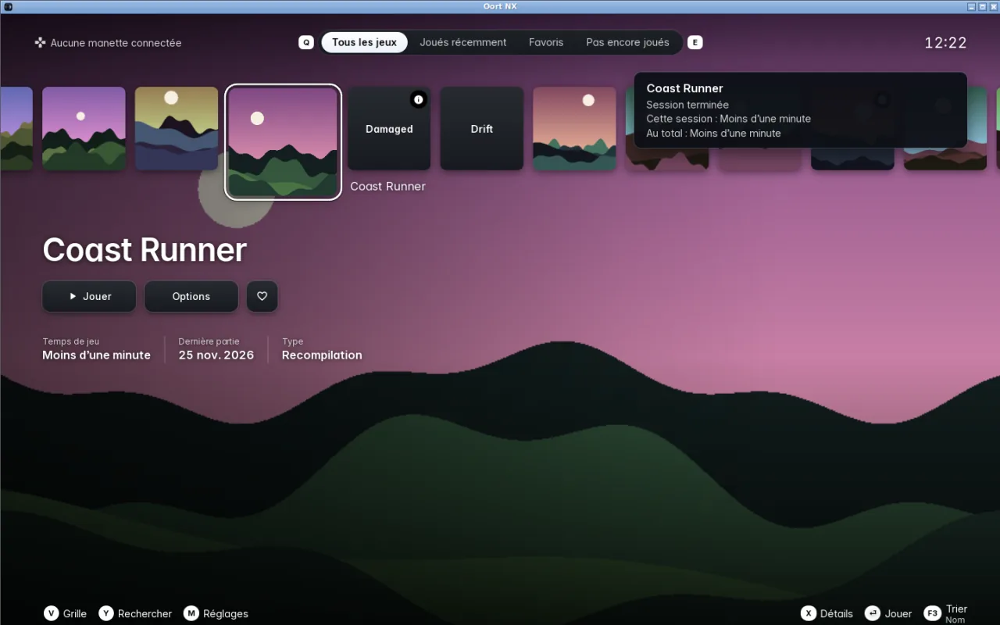

## Start
<!-- step play checked f18e2119:desktop/src-tauri/src/lib.rs f18e2119:desktop/tests/linux/prove.sh -->
Choose **Play**. The screen shows the game, then Oort steps aside.

## Come back
<!-- step back checked f18e2119:desktop/src-tauri/src/lib.rs f18e2119:desktop/tests/linux/prove.sh -->
Quit the game as usual: Oort comes back in front and shows how long you played.

## Close a stuck game
<!-- step close checked f18e2119:desktop/ui/app.js f18e2119:desktop/tests/play.js -->
Go back to the Oort window: **Close Game** appears after four seconds. What is not saved is lost. The Home button is not supported in a game yet.

