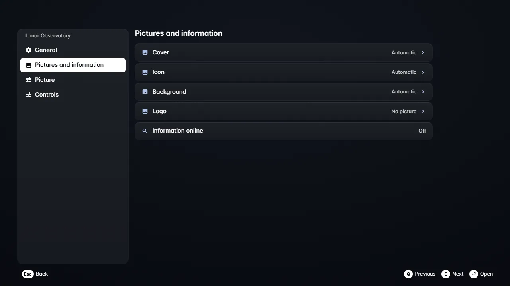

## They stay with the game
<!-- step where code f18e2119:Sources/OortCompanion/Places.swift f18e2119:Sources/OortCompanion/Companion.swift -->
Oort reads, copies and moves no save. They are where the game keeps them.

## Make your copy
<!-- step copy code f18e2119:desktop/ui/app.js f18e2119:desktop/src-tauri/src/lib.rs -->
**Options › Open folder** opens the game’s folder. Copy its saves yourself; some games keep them elsewhere.

