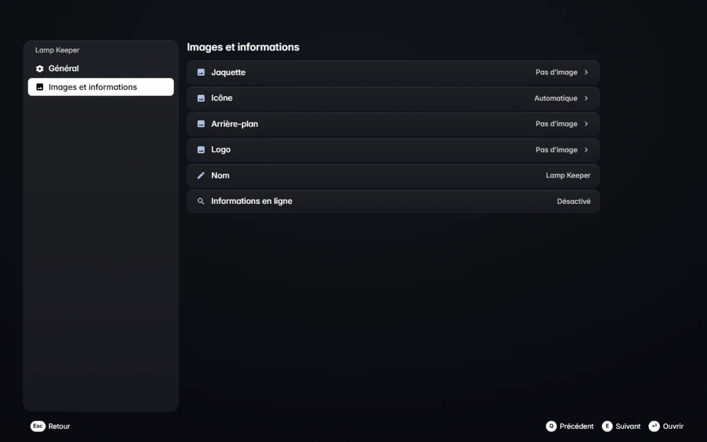
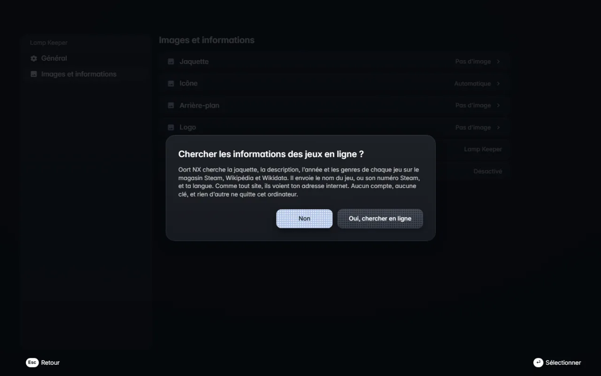
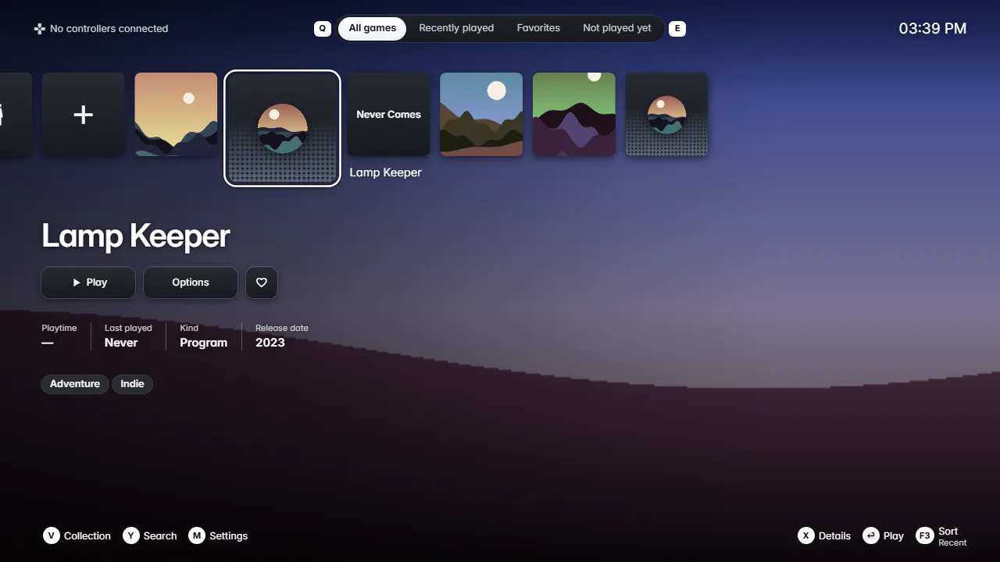
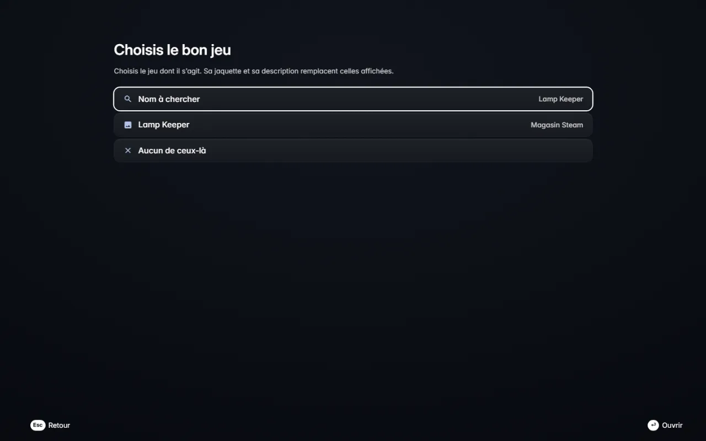
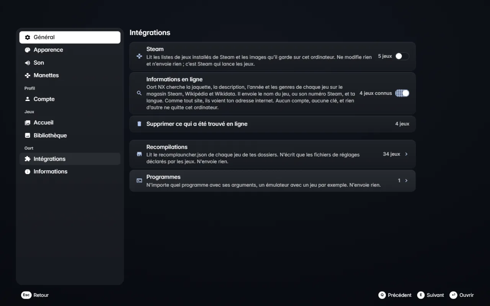

## Open the page
<!-- step open code f18e2119:desktop/ui/app.js f18e2119:Sources/OortCompanion/Companion+Own.swift -->
On a game: **Options › Pictures and information**.

## Choose your own pictures
<!-- step own code f18e2119:desktop/ui/app.js f18e2119:Sources/OortCompanion/Companion+Own.swift f18e2119:Tests/OortCompanionTests/OwnTests.swift -->
Cover, icon, background or logo: a PNG, JPEG or WebP file. It is copied into Oort’s folder; the original does not change.

## Look online, if you say yes
<!-- step ask code f18e2119:desktop/ui/app.js f18e2119:Sources/OortCompanion/Online.swift -->
Oort sends the game’s name or its Steam number, and your language, to the Steam store, Wikidata and Wikipedia. Checked with invented services, never with the real ones.

## See what was found
<!-- step found code f18e2119:desktop/ui/app.js f18e2119:Sources/OortCompanion/Online.swift -->
Cover, description, year and genres come by themselves. Wikipedia limits requests: it is mostly the Steam store that answers.

## Correct it
<!-- step right code f18e2119:desktop/ui/app.js f18e2119:Sources/OortCompanion/Online.swift -->
Wrong game? **Information online**, then the right one. **None of these** removes what came from the internet for that game.

## Turn it off or erase it
<!-- step off code f18e2119:desktop/ui/app.js f18e2119:Sources/OortCompanion/Online.swift -->
**Settings › Integrations** turns information online off and deletes everything that was found. Your own pictures stay.

