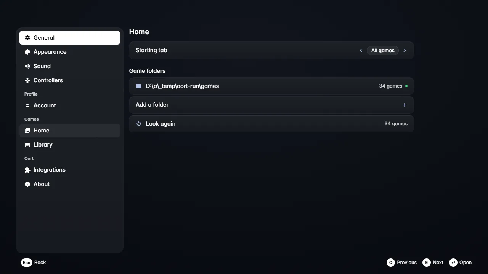
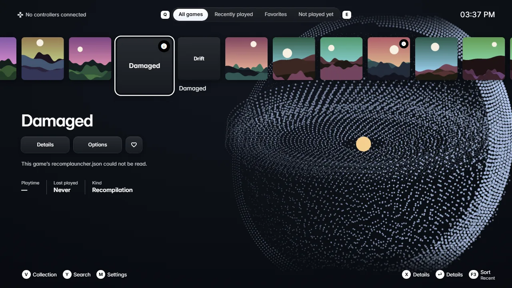
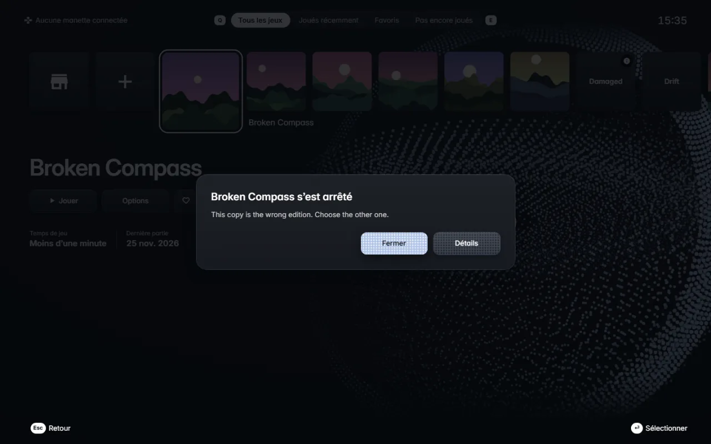
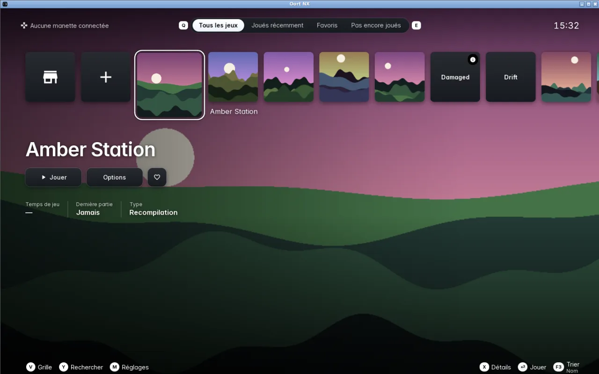

## A game is missing
<!-- step missing checked cc9db84a:desktop/ui/app.js cc9db84a:Sources/OortCompanion/Companion.swift -->
**Settings › Home › Look again**. For a recompilation, check that its folder holds `recomplauncher.json`.

## The game is marked unreadable
<!-- step unreadable checked cc9db84a:desktop/ui/app.js cc9db84a:desktop/tests/walk.js -->
Its `recomplauncher.json` is damaged or asks for a newer launcher. Take it again from the project.

## The game stops
<!-- step crash checked cc9db84a:desktop/src-tauri/src/lib.rs cc9db84a:desktop/tests/play.js -->
Oort shows the message the game left. Then check that the game starts on its own, outside Oort.

## The controller is not seen
<!-- step pad code cc9db84a:desktop/src-tauri/src/pad.rs cc9db84a:desktop/ui/nav.js -->
Press a button with the Oort window in front, then unplug it and plug it in again. Not tried with a real controller.

## Tell us
<!-- step report code cc9db84a:SECURITY.md cc9db84a:CONTRIBUTING.md -->
[Open a report](https://github.com/sofianbll/oort-nx/issues): what you were doing, what you saw, your version. Attach no game, key or save.

