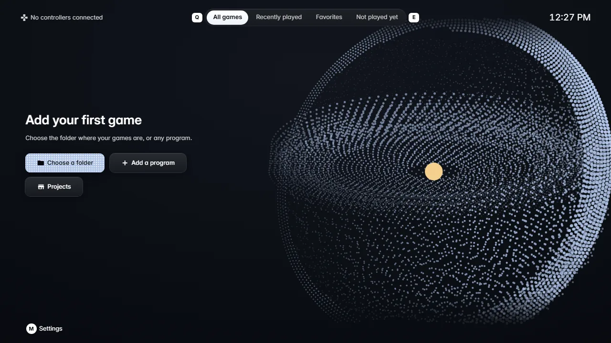

## See your version
<!-- step check code cc9db84a:desktop/README.md https://github.com/sofianbll/oort-nx/releases/tag/windows-v0.1.0-alpha.1 -->
It is in **Settings › About**. Oort does not look for updates by itself on this system.

## Install over it
<!-- step over code cc9db84a:desktop/tests/linux/prove.sh -->
Install the new .deb over it. Your library is in another folder; this move was not tried.

