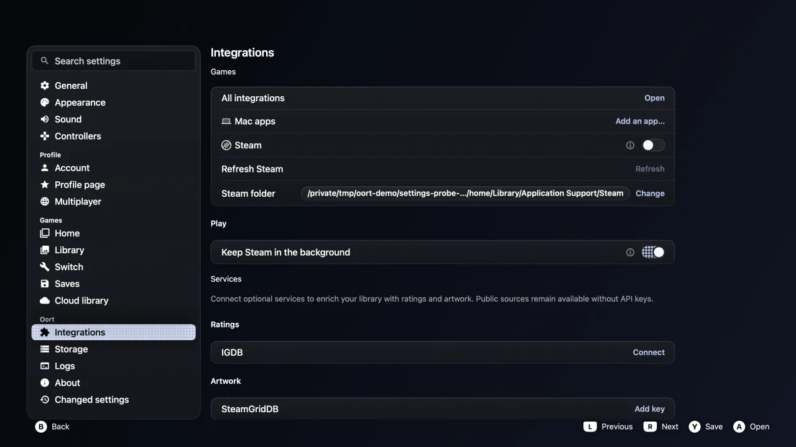

## Add it
<!-- step add checked bf0c3410:Tests/CatalogAppChecks/MacShortcutProbe.swift bf0c3410:Sources/NXLibrary/Views/Settings/SettingsSourcesSection.swift -->
**Settings › Integrations › Mac apps › Add an app…**, or drop an `.app` on the library.

## What Oort does
<!-- step what code bf0c3410:PLAYER-GUIDE.fr.md bf0c3410:Sources/NXLibraryCore/Catalog/MacShortcutRecord.swift -->
It opens the app, without changing it and without counting time. If it moves, use **Locate the app…**.

<!-- missing mac-app-tile: An invented Mac app in the library, options open. -->
