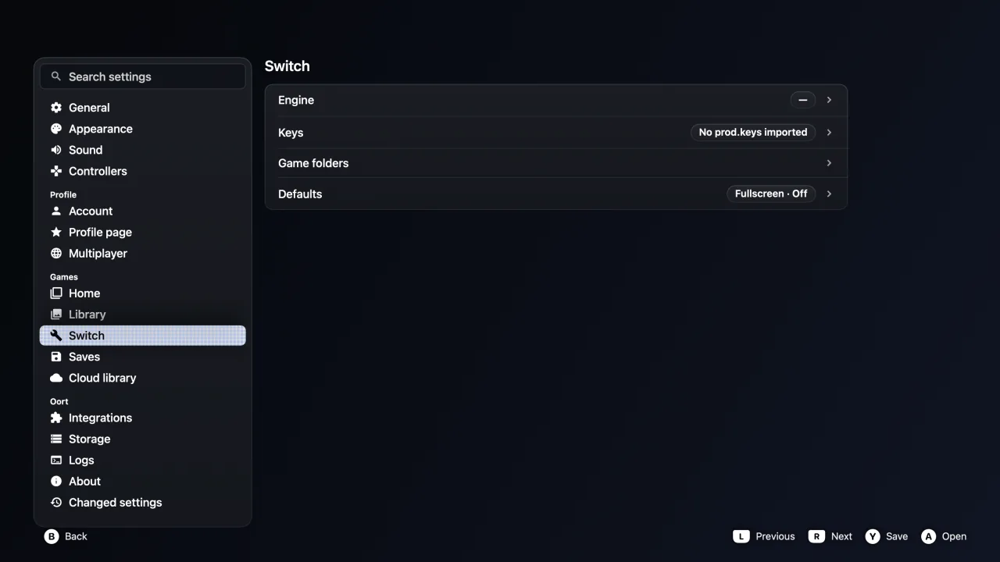
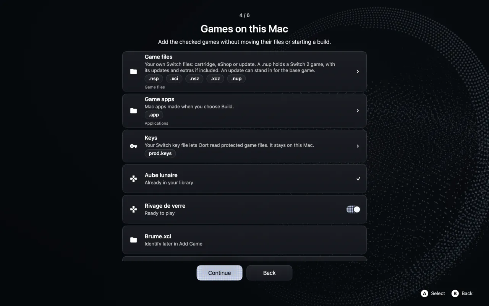
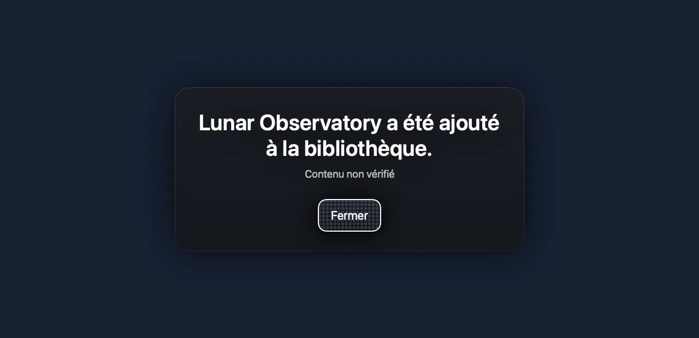

## Say where your apps are
<!-- step folder code bf0c3410:Sources/NXLibrary/Views/Settings/SettingsLibrarySection.swift bf0c3410:PLAYER-GUIDE.md -->
**Settings › Switch › Game folders**, **Game apps** row. Changing folder moves no app.

## Scan
<!-- step scan code bf0c3410:Sources/NXLibraryCore/Settings/SettingsCatalog.swift bf0c3410:PLAYER-GUIDE.md -->
**Library refresh › Refresh**. A game already built starts without Xcode or its original files.

## Or give a copy
<!-- step adopt checked bf0c3410:Tests/CatalogAppChecks/run_cloud_screens.py bf0c3410:Sources/NXLibrary/Views/AddGame/AddGameRows.swift -->
**Add game › Add ported app** copies the app and checks its signature. Only add what comes from a source you trust.

