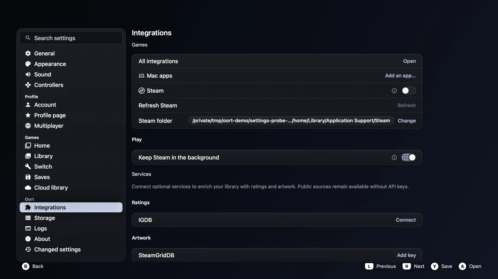
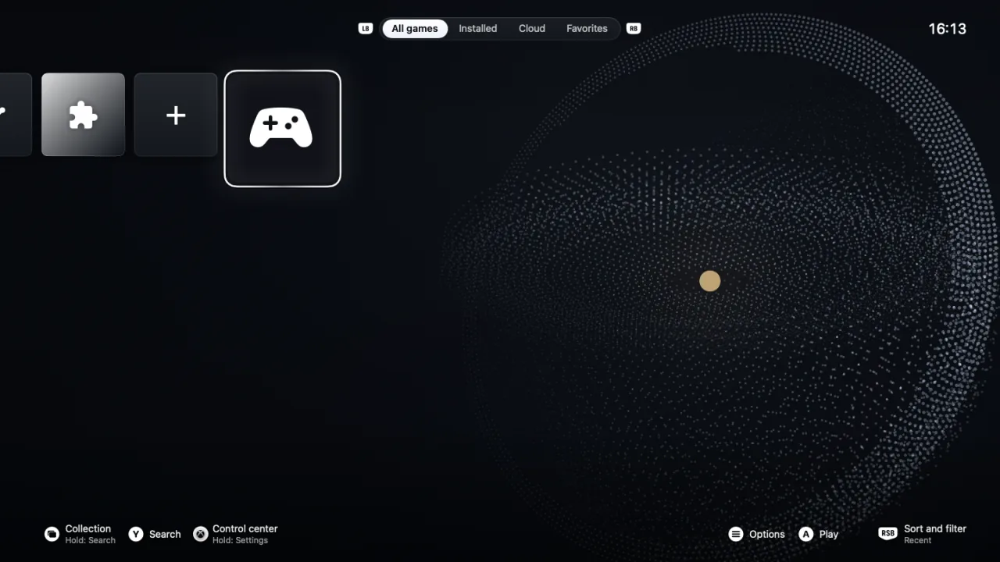

## Turn on Steam
<!-- step on checked bf0c3410:Sources/NXLibrary/Views/Settings/SettingsSourcesSection.swift bf0c3410:Tests/CatalogAppChecks/run_settings_confirmations.py -->
**Settings › Integrations › Steam**. Oort reads the list of installed games and writes nothing in Steam.

## Refresh
<!-- step refresh code bf0c3410:Sources/NXLibrary/Views/Settings/SettingsSourcesSection.swift bf0c3410:docs/how-it-works/steam.md -->
**Refresh Steam** reads the list again. Only installed Mac games show.

## Play
<!-- step play checked bf0c3410:Tests/CatalogAppChecks/run_profiles.py bf0c3410:docs/how-it-works/steam.md -->
**Play** goes through Steam, which opens the game. Checked with a fake Steam.

