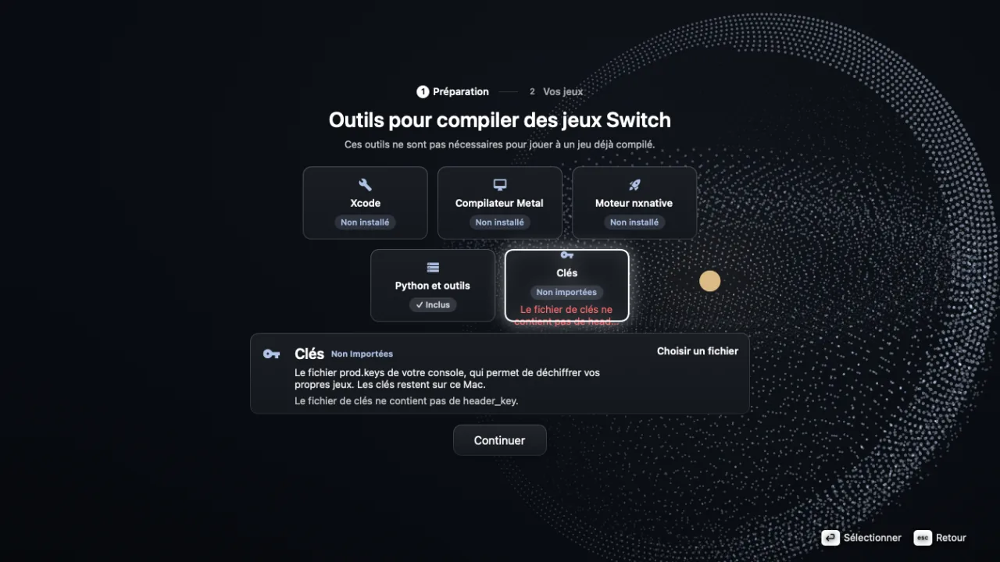
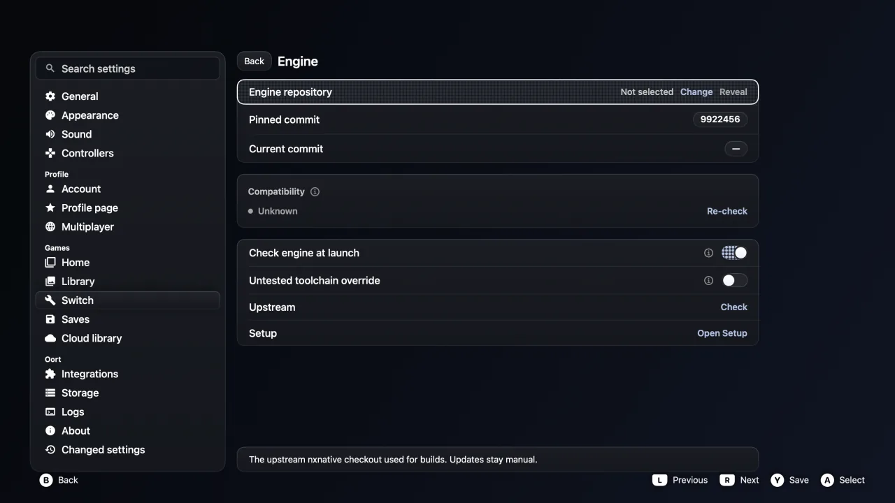
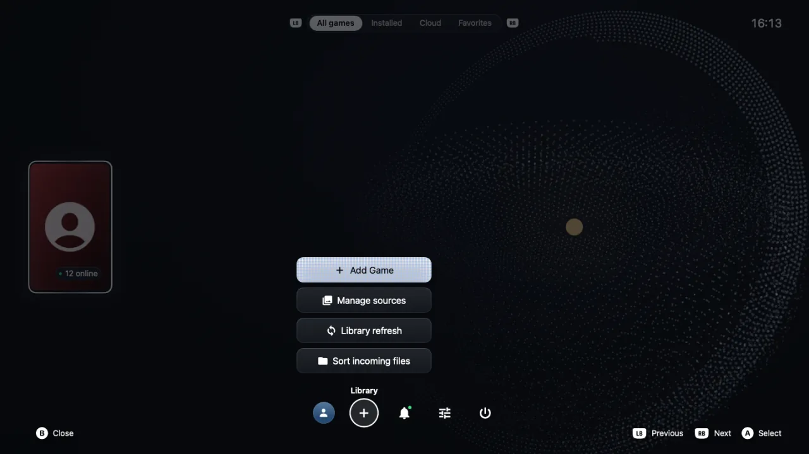
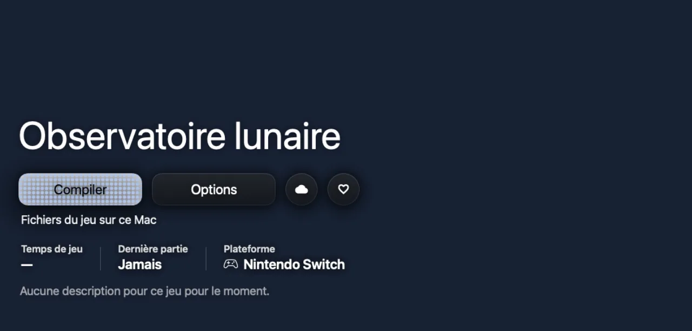

## What you need
<!-- step needs code bf0c3410:PLAYER-GUIDE.md bf0c3410:README.fr.md -->
Your own game files, your `prod.keys`, and the right to use them. Oort provides no game, key or firmware. Building also needs Xcode 27.2 or later, the expected Metal compiler and macOS 26.6.

## Prepare the tools
<!-- step tools code bf0c3410:Sources/NXLibrary/Views/Setup/SetupCheckView.swift bf0c3410:PLAYER-GUIDE.md -->
**Settings › Switch › Engine › Open Setup** shows what is missing. Each installation asks first and shows where it goes.

## Choose the files
<!-- step choose code bf0c3410:Sources/NXLibrary/Views/AddGame/AddGameView.swift bf0c3410:Sources/NXLibrary/Views/AddGame/AddGameRows.swift -->
**Add game**, or ⌘N, then your NSP, XCI, NSZ, XCZ or NUP files. They stay where they are.

## Review
<!-- step review code bf0c3410:Sources/NXLibrary/Views/AddGame/AddGameView.swift bf0c3410:PLAYER-GUIDE.md -->
Look at the game, update, DLC, destination and space. **Add to library only** keeps the game for later.

<!-- missing add-review: The Review step with an invented game. -->

## Build
<!-- step build code bf0c3410:Sources/NXLibrary/Views/AddGame/AddGameStepThreeView.swift bf0c3410:PLAYER-GUIDE.md -->
**Add and port** starts the engine; you can close the screen, it goes on. How long depends on the game and the Mac. No real game was built with this version.

