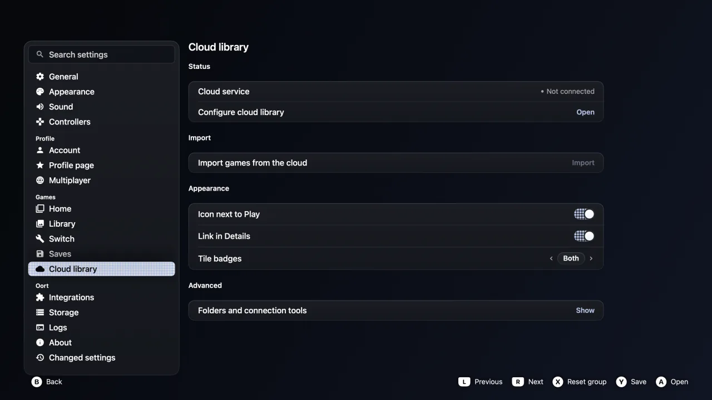
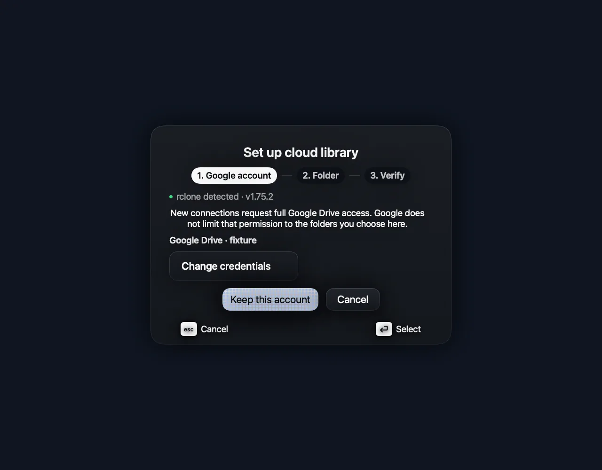
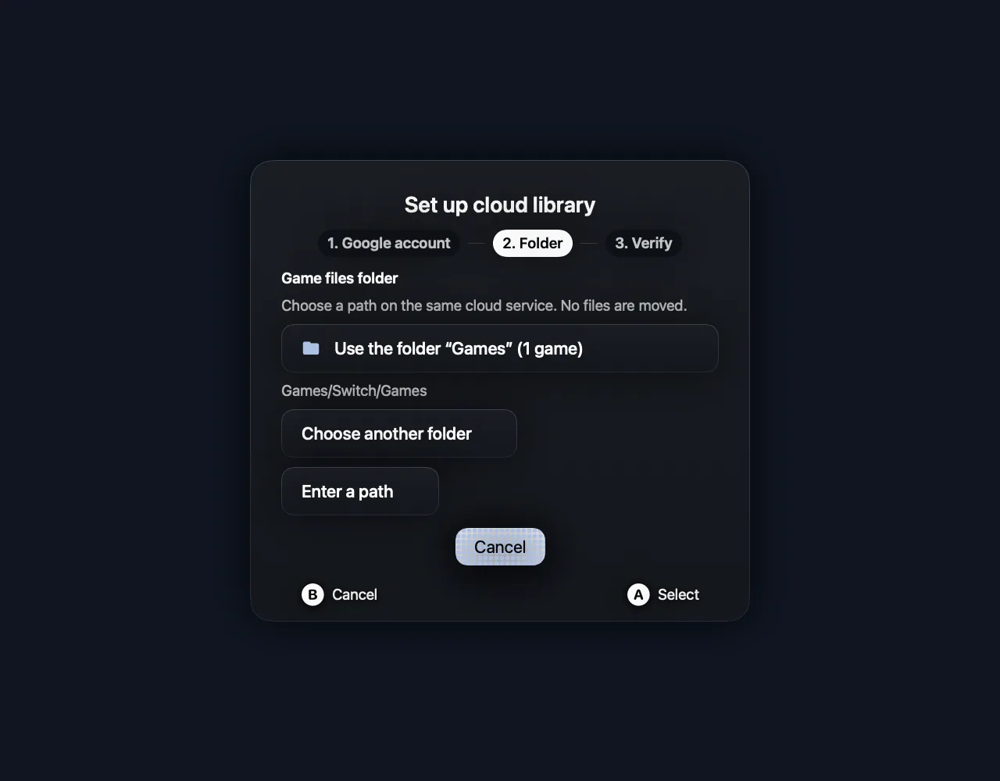
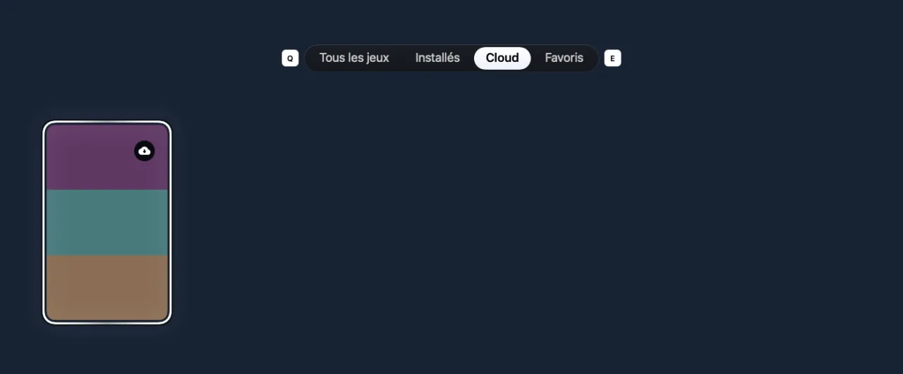

## What it is for
<!-- step what code bf0c3410:PLAYER-GUIDE.md bf0c3410:Sources/NXLibraryCore/Library/RcloneConfiguration.swift -->
Keeping your built games online and finding them on another Mac. Only Google Drive is supported, and your saves are not in it. **Keep a copy of what matters.**

## The tool: rclone
<!-- step tool code bf0c3410:Sources/NXLibraryCore/Library/RcloneDownload.swift bf0c3410:Sources/NXLibrary/Views/Settings/SettingsCloudLibrarySection.swift -->
Oort uses the rclone already on your Mac, or asks before taking rclone.org’s. **Advanced** lets you choose yours.

## Connect Google
<!-- step account checked bf0c3410:Sources/NXLibrary/Views/Settings/CloudSetupAssistant.swift bf0c3410:Tests/CatalogAppChecks/run_cloud_screens.py -->
Keep an existing connection, or **Sign in**. Google gives rclone access to your whole Drive, not to one folder.

## Choose the folder
<!-- step folder checked bf0c3410:Sources/NXLibrary/Views/Settings/CloudSetupAssistant.swift bf0c3410:Tests/CatalogAppChecks/run_cloud_screens.py -->
Oort looks for a library in `Games`, otherwise you give a path. This choice moves nothing.

## Download a game
<!-- step use checked bf0c3410:Tests/CatalogAppChecks/run_store_next_step.py bf0c3410:Tests/CatalogAppChecks/run_cloud_screens.py -->
The **Cloud** tab shows what is online. **Download app** brings it back; **Download game files** then asks you to build.

## Unplug
<!-- step stop code bf0c3410:Sources/NXLibrary/Views/Settings/SettingsCloudLibrarySection.swift bf0c3410:PLAYER-GUIDE.md -->
**Disconnect** removes the connection from this Mac. Files stay in your Drive. Other tools may use that rclone connection.

