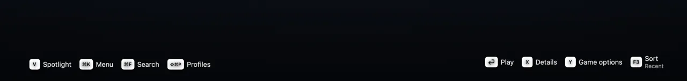
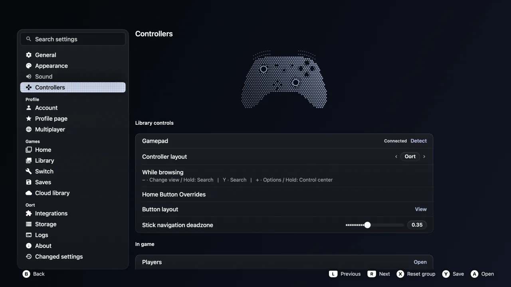

## The useful buttons
<!-- step keys checked bf0c3410:Tests/CatalogAppChecks/run_keymap_screens.py bf0c3410:docs/how-it-works/keymap.md -->
Reminders are at the bottom of the screen.

| Action | Xbox | Switch | PlayStation | Keyboard |
|---|---|---|---|---|
| Play, select | A | A | Cross | Return |
| Back | B | B | Circle | Escape |
| Details | X | X | Square | X |
| Search | Y | Y | Triangle | ⌘F |
| Game options | Menu | + | Options | Y |
| Grid or spotlight | View | − | Touchpad | V |
| Previous, next tab | LB / RB | L / R | L1 / R1 | Q / E |
| Sort | Right stick | Right stick | R3 | F3 |
| Control center | Hold Menu | Hold + | Hold Options | ⌘K |
| Settings | Hold Guide | Hold Home | Hold PS | ⌘, |

## Two layouts
<!-- step layout code bf0c3410:docs/how-it-works/keymap.md bf0c3410:Sources/NXLibraryCore/Settings/SettingsCatalog.swift -->
This table is the **Oort** layout. An earlier profile keeps **Arcane**, where settings are on held Menu: **Settings › Controllers › Controller layout**.

## The Home button
<!-- step home code bf0c3410:docs/how-it-works/keymap.md bf0c3410:Sources/NXLibrary/Views/Settings/SettingsControllersSection.swift -->
If macOS keeps it, Oort says so once. **Home Button Overrides** opens the macOS setting.

## Try your controller
<!-- step see checked bf0c3410:Tests/CatalogAppChecks/run_controller_identity.py bf0c3410:Sources/NXLibrary/Views/OortUI/OortControllerView.swift -->
In **Settings › Controllers**, it is drawn in dots and lights what you press. Not tried with a real controller in this version.

