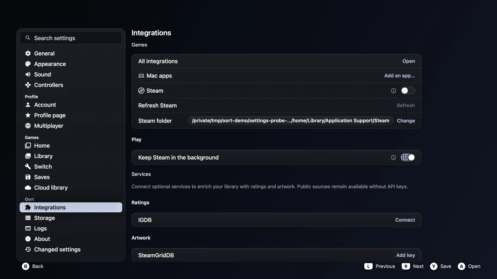
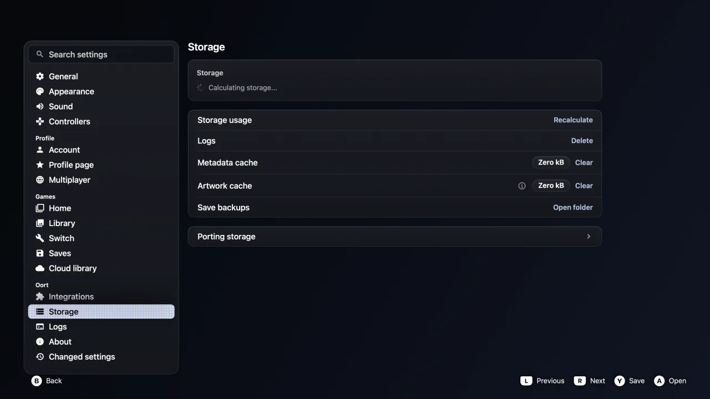
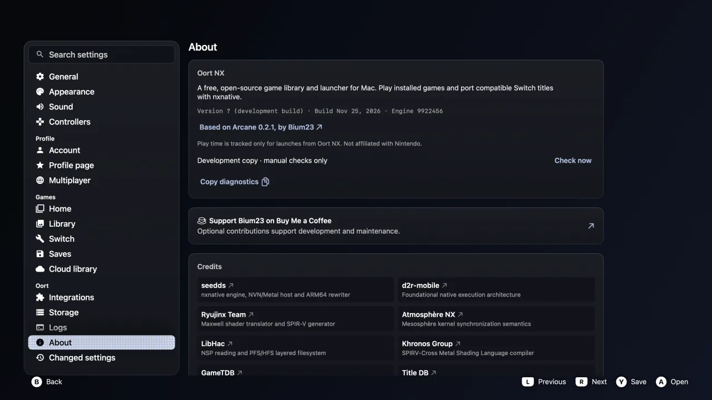
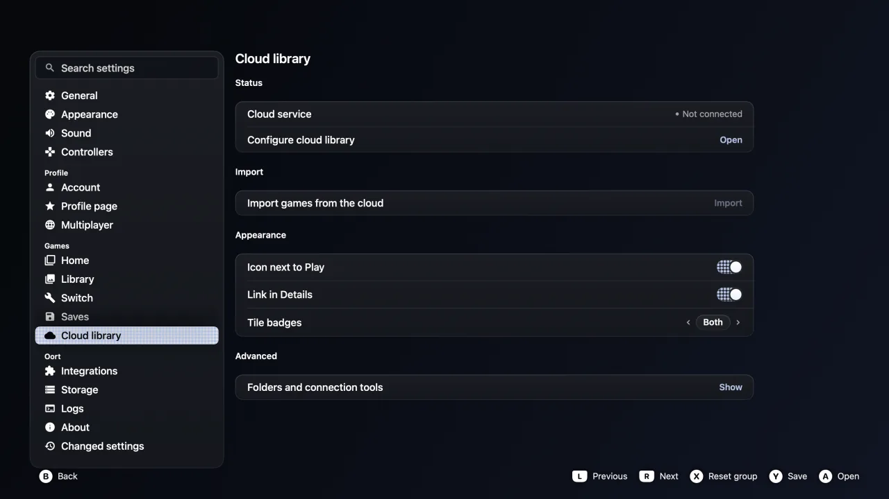

## Reads
<!-- step reads code bf0c3410:docs/how-it-works/steam.md bf0c3410:docs/how-it-works/architecture.md -->
The folders you choose. If you turn it on, Steam’s game lists. If you build, your files and your keys, on this Mac.

## Writes
<!-- step writes code bf0c3410:docs/how-it-works/architecture.md bf0c3410:Sources/NXLibraryCore/App/AppDataProfile.swift -->
`~/Library/Application Support/Oort NX`, the apps it builds, and the settings and mods of built games. Nothing in Steam. Only you can read the copy of your keys.

## Sends, by itself
<!-- step alone code bf0c3410:Sources/NXLibraryCore/Resources/Localizable.xcstrings bf0c3410:docs/how-it-works/architecture.md -->
It asks GitHub whether a newer version exists. It looks for pictures, scores and descriptions with your games’ name or number: Nlib, GameTDB, Steam, Wikidata, Wikipedia and other public sources.

## Sends, if you ask
<!-- step asked code bf0c3410:Sources/NXLibraryCore/Resources/Localizable.xcstrings bf0c3410:PLAYER-GUIDE.md -->
Google Drive, Nextendo, GameBanana mods, SteamGridDB, IGDB: only once turned on, with your own account where one is needed. Building sends no game file and no key.

