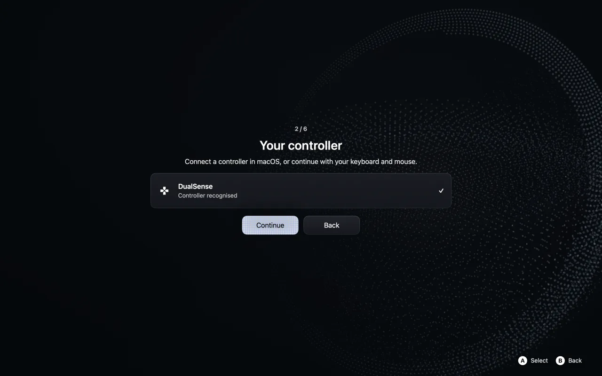
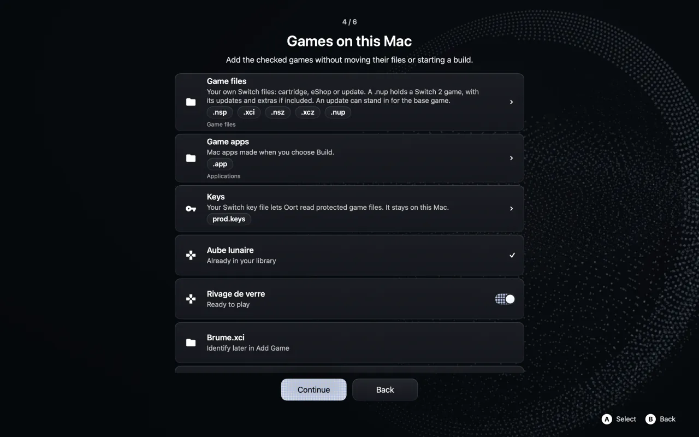
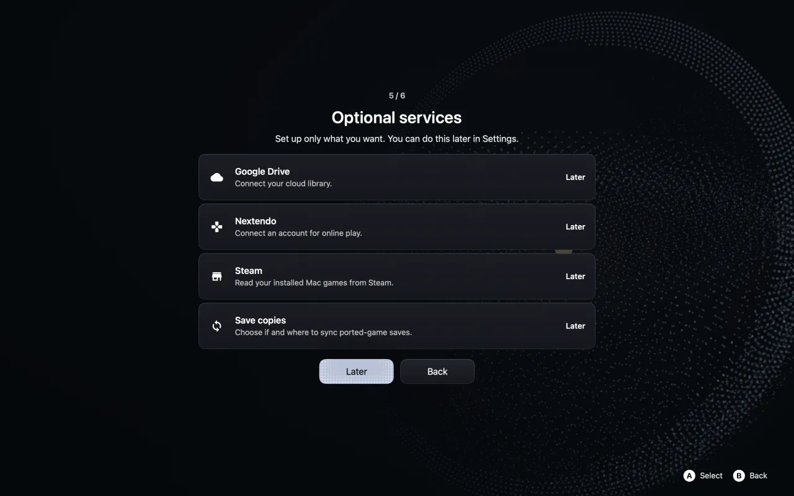
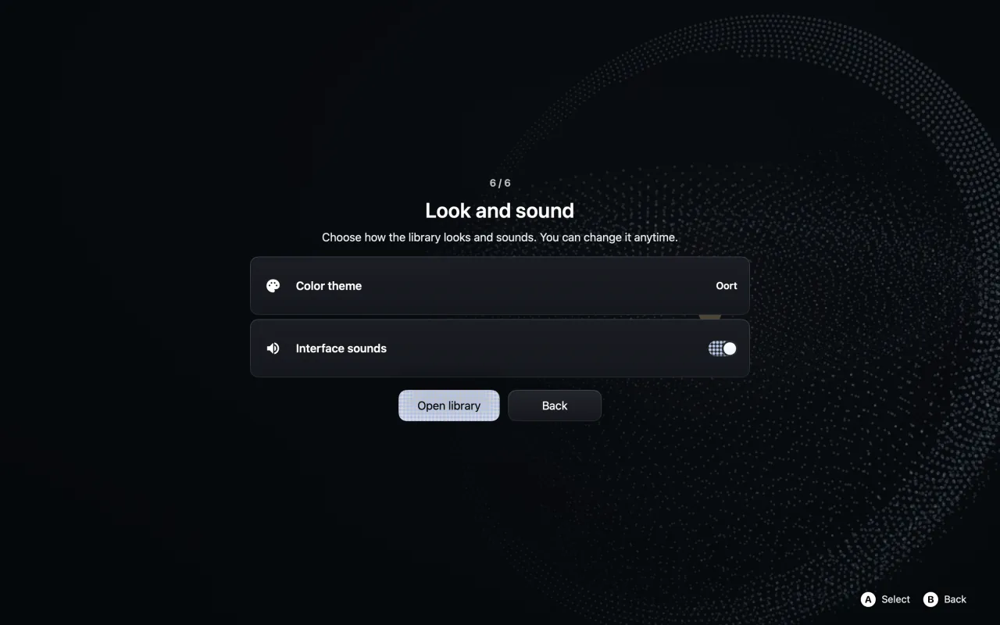

## Coming from 0.3.0?
<!-- step old code bf0c3410:Sources/NXLibraryCore/App/AppDataProfile.swift bf0c3410:CHANGELOG.md https://github.com/sofianbll/oort-nx/releases/tag/v0.5.0-beta.3 -->
Your library is copied and every file checked; the old one stays intact. Sign in to your services once, and do not open both versions together.

<!-- missing library-copy: The 0.3.0 library copy screen. -->

## Your controller
<!-- step controller checked bf0c3410:Sources/NXLibrary/Views/Setup/OnboardingView.swift bf0c3410:Tests/CatalogAppChecks/run_onboarding.py -->
The tour says whether it is recognised. Otherwise, go on with keyboard or mouse.

## Games already here
<!-- step games checked bf0c3410:Sources/NXLibrary/Views/Setup/OnboardingView.swift bf0c3410:Tests/CatalogAppChecks/run_onboarding.py -->
Oort lists the game apps it finds and the files of a folder you choose. Adding moves nothing and builds nothing.

## Services, later
<!-- step services checked bf0c3410:Sources/NXLibrary/Views/Setup/OnboardingView.swift bf0c3410:Tests/CatalogAppChecks/run_onboarding.py -->
Google Drive, Nextendo, Steam and save copies are optional. **Later** leaves them off.

## Take the tour again
<!-- step again code bf0c3410:Sources/NXLibraryCore/Settings/SettingsCatalog.swift bf0c3410:PLAYER-GUIDE.md -->
**Settings › General › Welcome setup**. Nothing is reset.

