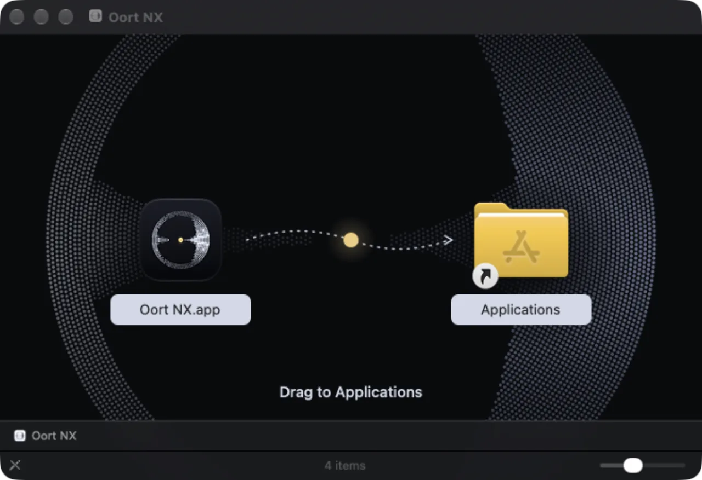
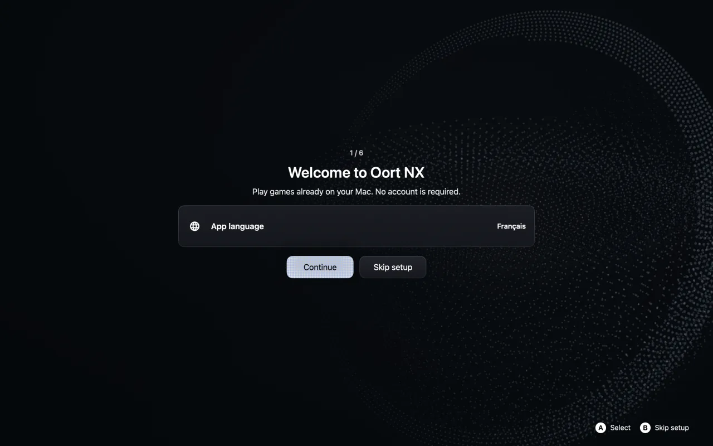

## Download
<!-- step download code bf0c3410:README.fr.md bf0c3410:Package.swift https://github.com/sofianbll/oort-nx/releases/tag/v0.5.0-beta.3 -->
Take `Oort-NX-0.5.0-beta.3.dmg` from the [release page](https://github.com/sofianbll/oort-nx/releases/tag/v0.5.0-beta.3). You need an Apple silicon Mac and macOS 26 or later.

<!-- missing release-page: The release page, DMG visible. -->

## Drag to Applications
<!-- step drag checked bf0c3410:scripts/build_dmg.sh bf0c3410:scripts/style_dmg.py -->
Open the DMG and drop Oort NX on Applications.

## Go past the warning
<!-- step warning elsewhere https://support.apple.com/102445 https://github.com/sofianbll/oort-nx/releases/tag/v0.5.0-beta.3 -->
Apple has not notarised the app: the first opening is refused. Go to **System Settings › Privacy & Security**, then **Open Anyway** ([Apple explains](https://support.apple.com/102445)). Do not turn off macOS protections.

<!-- missing gatekeeper: macOS refusing, then Open Anyway. -->

## Open Oort NX
<!-- step open checked bf0c3410:Sources/NXLibrary/Views/Setup/OnboardingView.swift bf0c3410:Tests/CatalogAppChecks/run_onboarding.py -->
The welcome tour starts. You can skip it.

