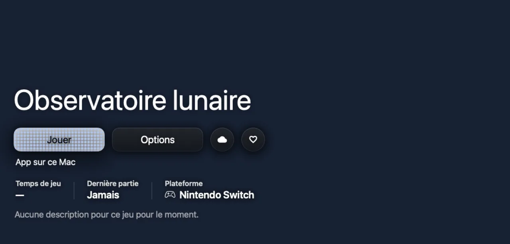
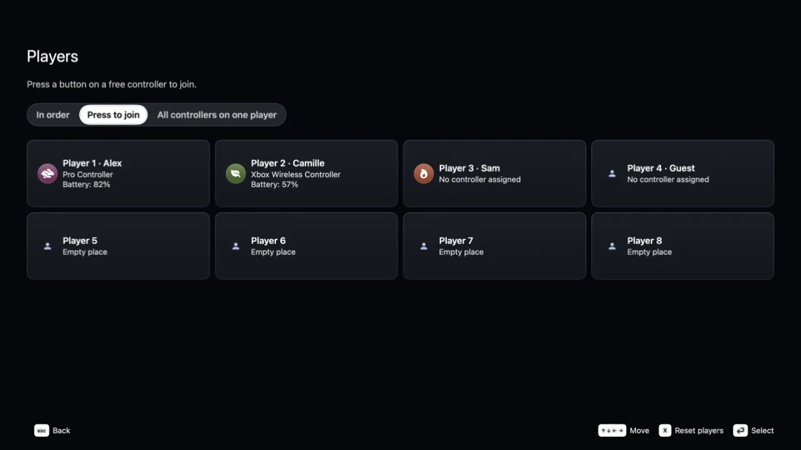

## Start
<!-- step play checked bf0c3410:Tests/CatalogAppChecks/run_store_next_step.py bf0c3410:Tests/CatalogAppChecks/run_profiles.py -->
Choose a game, then **Play**. The button always says the next step: Play, Build, Download.

## Come back
<!-- step back code bf0c3410:docs/how-it-works/flows.md bf0c3410:PLAYER-GUIDE.md -->
Quit the game: Oort comes back in front, unless you moved to another app. On a recently built game, Home also offers to come back without closing it.

<!-- missing session-card: The session card, with an invented game. -->

## Play together
<!-- step together checked bf0c3410:Tests/CatalogAppChecks/run_players_screen.py bf0c3410:Sources/NXLibrary/Views/Players/PlayersScreen.swift -->
The **Players** screen places up to eight players. The game follows it only if its build supports it.

