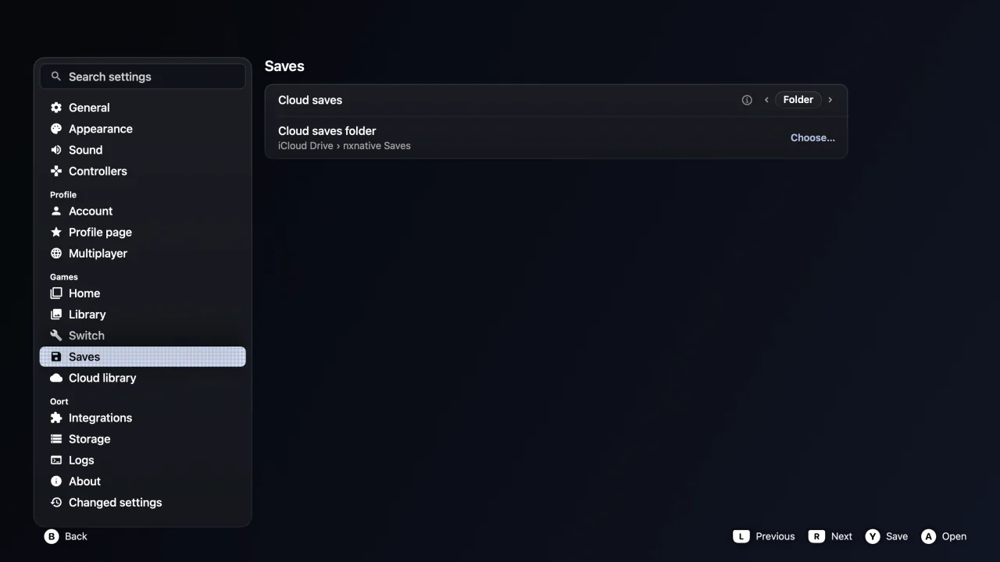
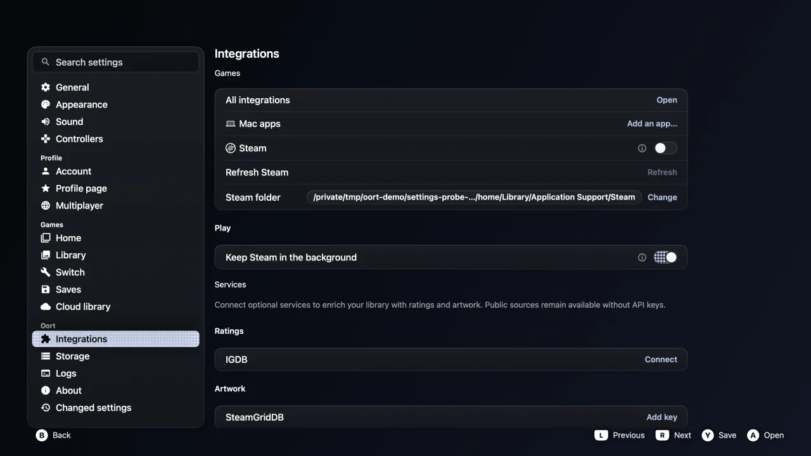

## Make a copy
<!-- step backup code bf0c3410:Sources/NXLibrary/Views/GameOptions/SavesPanel.swift bf0c3410:PLAYER-GUIDE.fr.md -->
Game closed: **Game options › Saves › Back up now**. It is dated and verified.

<!-- missing saves-panel: The Saves panel with an invented game. -->

## Restore
<!-- step restore code bf0c3410:Sources/NXLibrary/Views/GameOptions/SaveImportDetails.swift bf0c3410:PLAYER-GUIDE.fr.md -->
**Import save…**, choose the copy, read the preview, confirm. Oort first copies the current save.

<!-- missing save-import: The import preview, invented save. -->

## Sync, or not
<!-- step sync checked bf0c3410:Sources/NXLibrary/Views/Settings/SettingsCloudSavesSection.swift bf0c3410:Tests/CatalogAppChecks/run_settings_confirmations.py -->
**Settings › Saves**: off, iCloud Drive or a folder of yours. Turn it off to import or restore. Syncing does not replace a copy.

## Steam and Mac apps
<!-- step steam code bf0c3410:docs/how-it-works/steam.md bf0c3410:PLAYER-GUIDE.md -->
Oort does not touch their saves.

