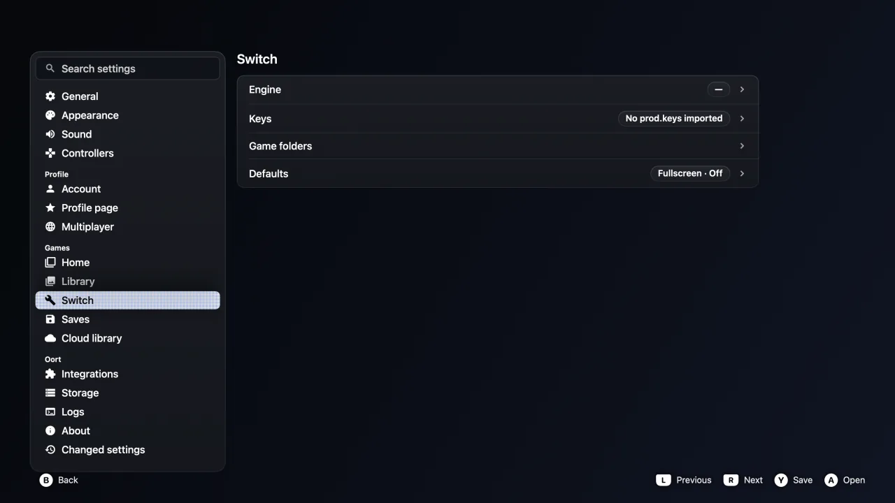
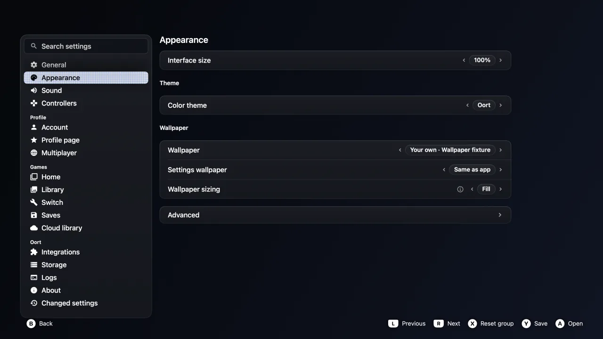
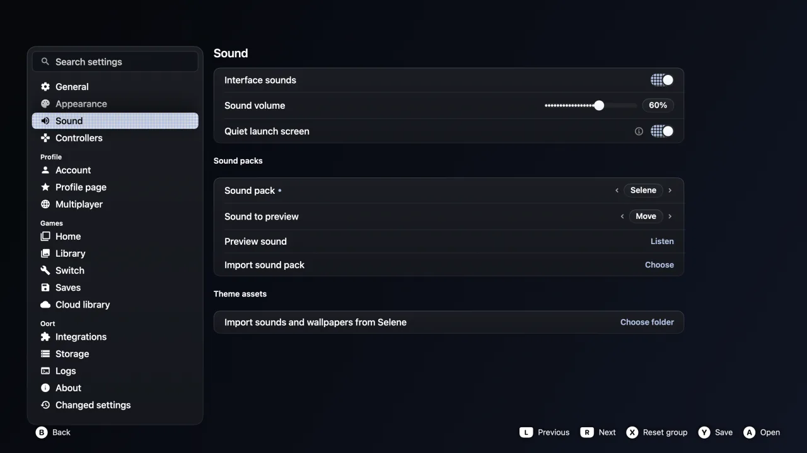
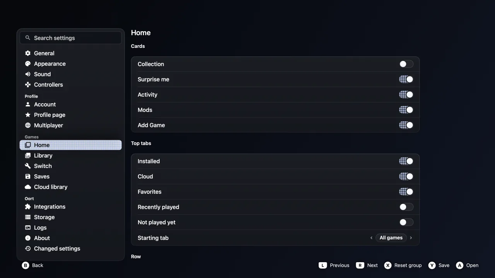
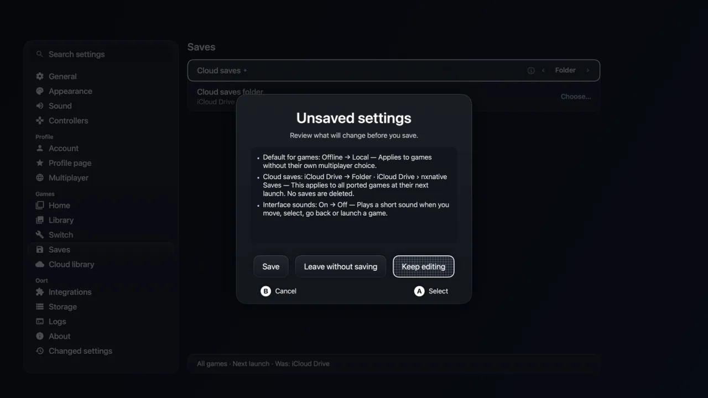

## Find a setting
<!-- step find checked bf0c3410:Tests/CatalogAppChecks/run_settings_confirmations.py bf0c3410:Sources/NXLibrary/Views/Settings/SettingsView.swift -->
Search at the top of the list. **Changed settings** shows what you changed.

## Colours and size
<!-- step look checked bf0c3410:Tests/CatalogAppChecks/run_settings_confirmations.py -->
**Settings › Appearance**: theme, background and interface size, from 80 to 125%.

## Sounds
<!-- step sound checked bf0c3410:Tests/CatalogAppChecks/run_settings_confirmations.py -->
**Settings › Sound**: volume, sound pack, and your own notes with **Compose**.

## The home screen
<!-- step home checked bf0c3410:Tests/CatalogAppChecks/run_settings_confirmations.py -->
**Settings › Home** chooses the cards and tabs.

## Save
<!-- step save checked bf0c3410:Tests/CatalogAppChecks/run_settings_confirmations.py -->
Oort asks before leaving if a setting is not saved.

