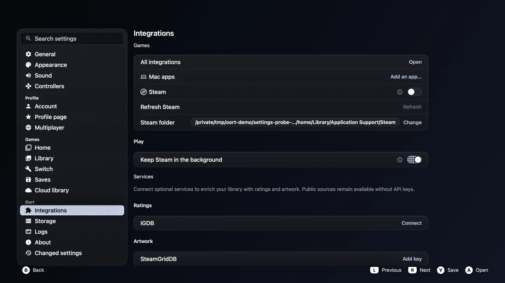
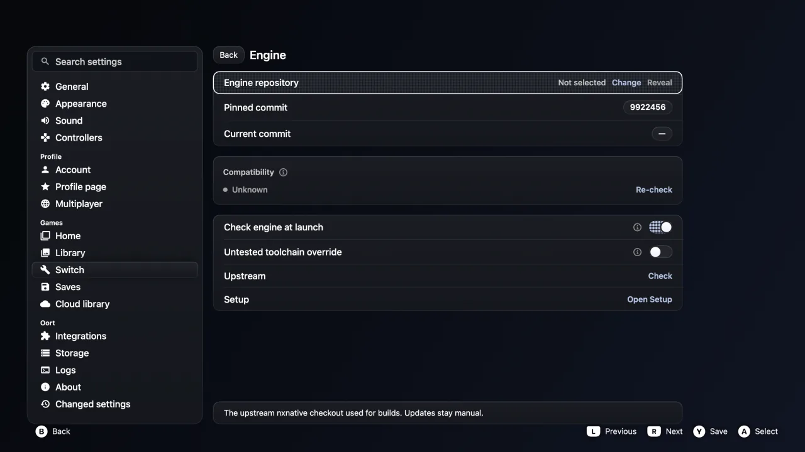
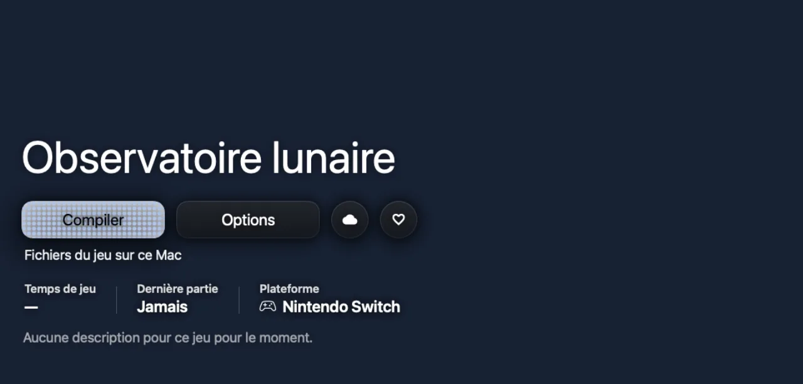
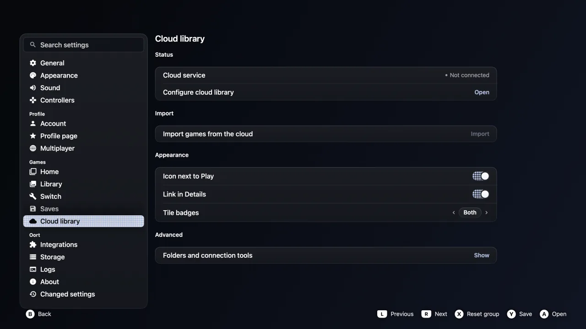
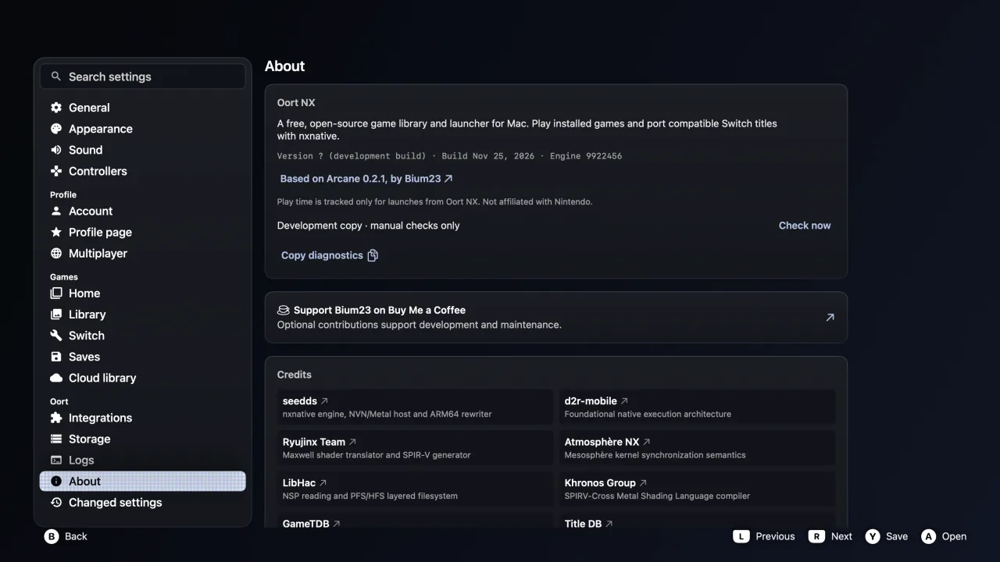

## A Steam game is missing
<!-- step steam code bf0c3410:PLAYER-GUIDE.md bf0c3410:Sources/NXLibrary/Views/Settings/SettingsSourcesSection.swift -->
**Settings › Integrations**: check the Steam folder, then **Refresh Steam**. The game must be installed and made for Mac.

## Building is blocked
<!-- step build checked bf0c3410:Tests/CatalogAppChecks/run_build_gates.py bf0c3410:PLAYER-GUIDE.md -->
**Settings › Switch › Engine** says what is wrong. A game already built still starts.

## Game files not found
<!-- step files code bf0c3410:PLAYER-GUIDE.md bf0c3410:Sources/NXLibrary/Views/GameOptions/GameOptionsView+Rows.swift -->
To rebuild: **Game options › Edit details › Attach sources…**. To play, the app is enough.

## The cloud does not answer
<!-- step cloud checked bf0c3410:Tests/CatalogAppChecks/run_cloud_shelf.py bf0c3410:Sources/NXLibrary/Views/Settings/SettingsCloudLibrarySection.swift -->
**Settings › Cloud library**, then test the connection. Oort keeps the last known state and says so.

## Tell us
<!-- step report code bf0c3410:SECURITY.md bf0c3410:CONTRIBUTING.md -->
[Open a report](https://github.com/sofianbll/oort-nx/issues): what you were doing, what you saw, your versions. Read **Copy diagnostics** before pasting it. Attach no game, key or save.

