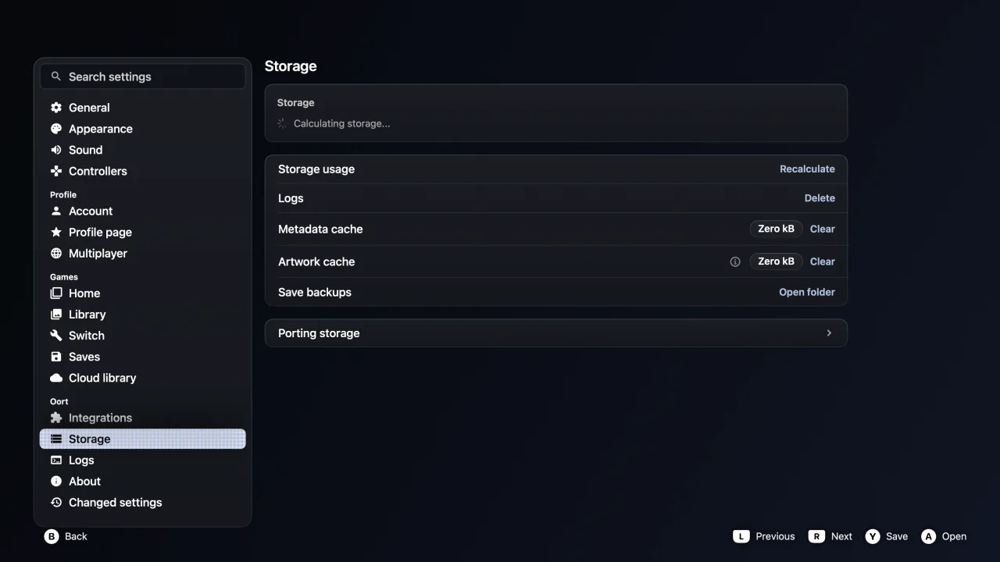

## Remove the app
<!-- step app code bf0c3410:PLAYER-GUIDE.md bf0c3410:Sources/NXLibraryCore/App/AppDataProfile.swift -->
Move Oort NX to the Trash. Your built games, files and saves stay.

<!-- missing trash: Oort NX dragged to the Trash. -->

## Erase its library if you like
<!-- step data code bf0c3410:Sources/NXLibraryCore/App/AppDataProfile.swift bf0c3410:docs/how-it-works/architecture.md -->
It is in `~/Library/Application Support/Oort NX`. Careful: your save backups and the copy of your keys are there too.

## Games stay playable
<!-- step games code bf0c3410:docs/how-it-works/architecture.md bf0c3410:PLAYER-GUIDE.md -->
A built game is a Mac app: it opens without Oort. Its saves are in `~/Library/Application Support/nxnative`.

