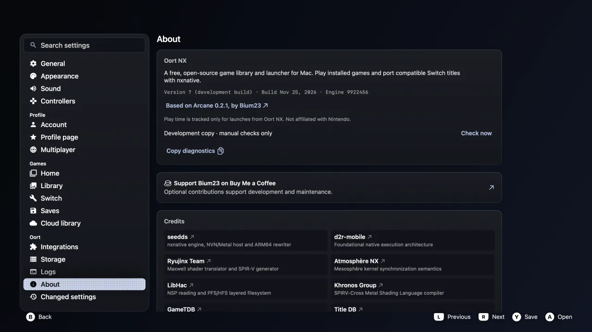
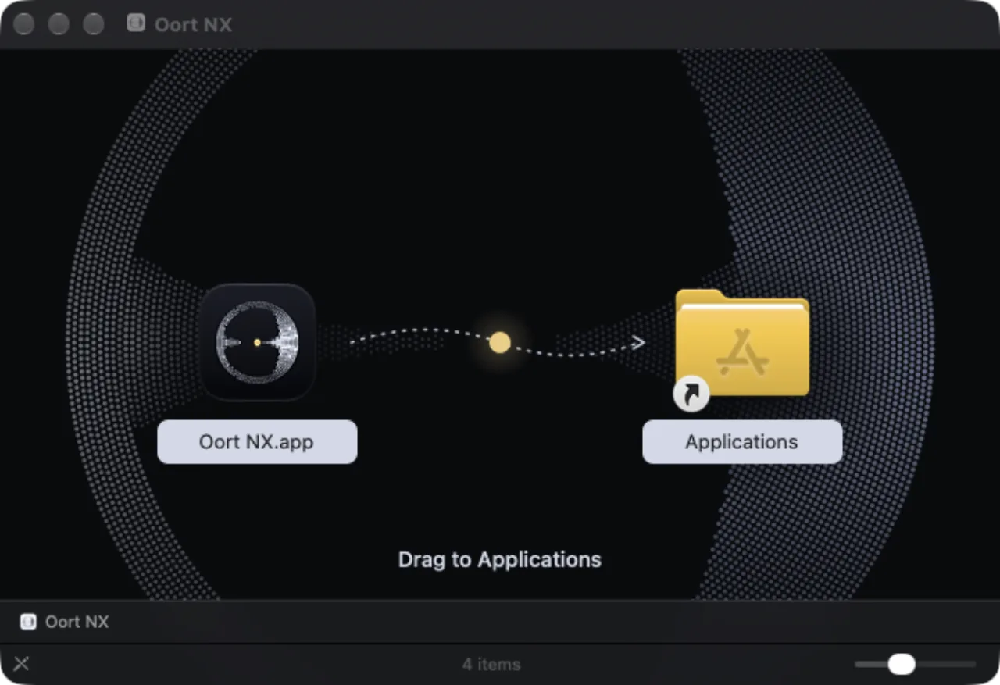

## Check
<!-- step check checked bf0c3410:Tests/CatalogAppChecks/run_settings_confirmations.py bf0c3410:Sources/NXLibraryCore/Settings/SettingsCatalog.swift -->
**Settings › About › Check now**. Oort also looks by itself, once a day at most.

## Install
<!-- step install code bf0c3410:docs/how-it-works/flows.md bf0c3410:CHANGELOG.md -->
**Update** downloads, checks, replaces and reopens Oort. It waits for a build or a game to end.

<!-- missing update-dialog: The update window with an invented version. -->

## From 0.3.0
<!-- step old code bf0c3410:CHANGELOG.md bf0c3410:PLAYER-GUIDE.fr.md -->
It cannot move to this version by itself: install the DMG once.

