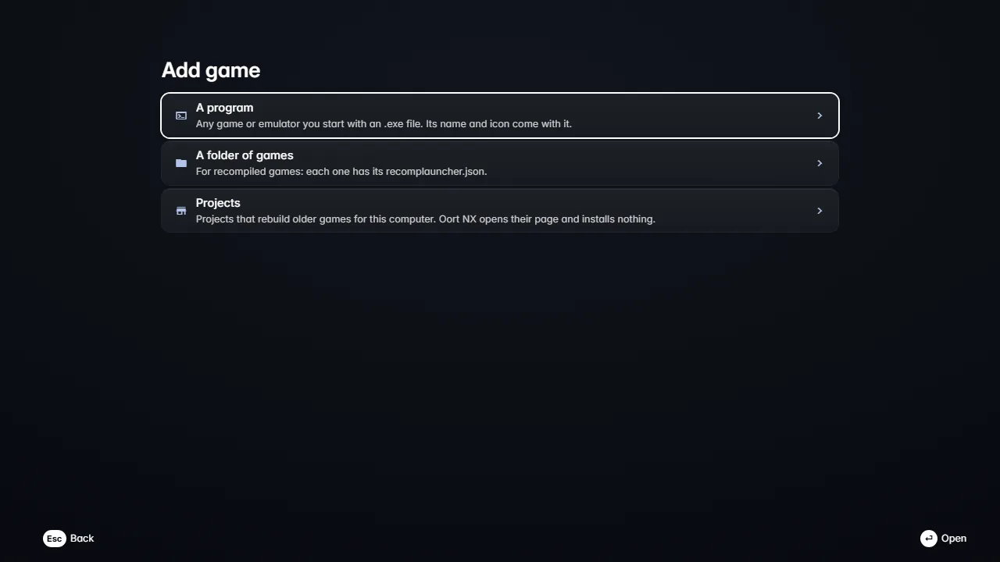
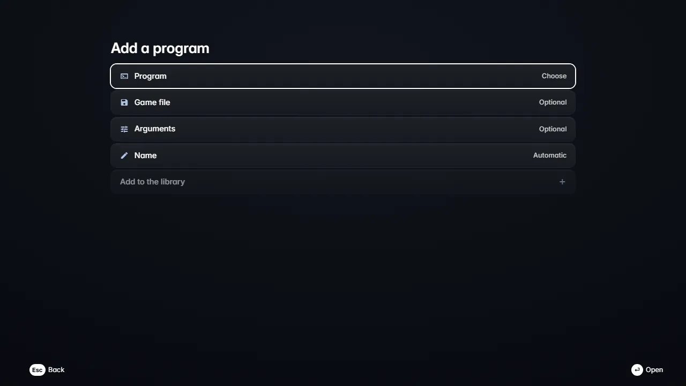

## Open Add game
<!-- step add checked cc9db84a:desktop/ui/app.js -->
Choose the **+** tile, then **A program**.

## Choose the file
<!-- step program code cc9db84a:desktop/ui/app.js cc9db84a:Sources/OortCompanion/Launch.swift -->
**Program** is the .exe file of the game or the emulator. For an emulator, **Game file** is the game it must open.

## Add it
<!-- step finish code cc9db84a:desktop/ui/app.js cc9db84a:Sources/OortCompanion/Companion.swift -->
Give it a name if you like, then **Add to the library**. In this version it has no icon or cover: its name shows on the tile.

