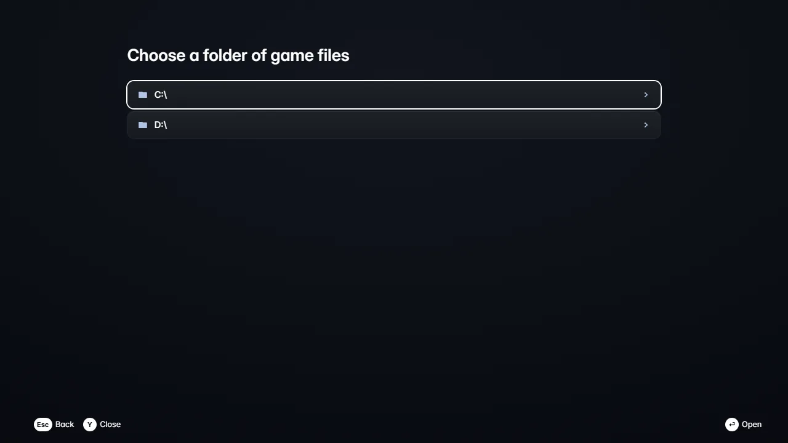
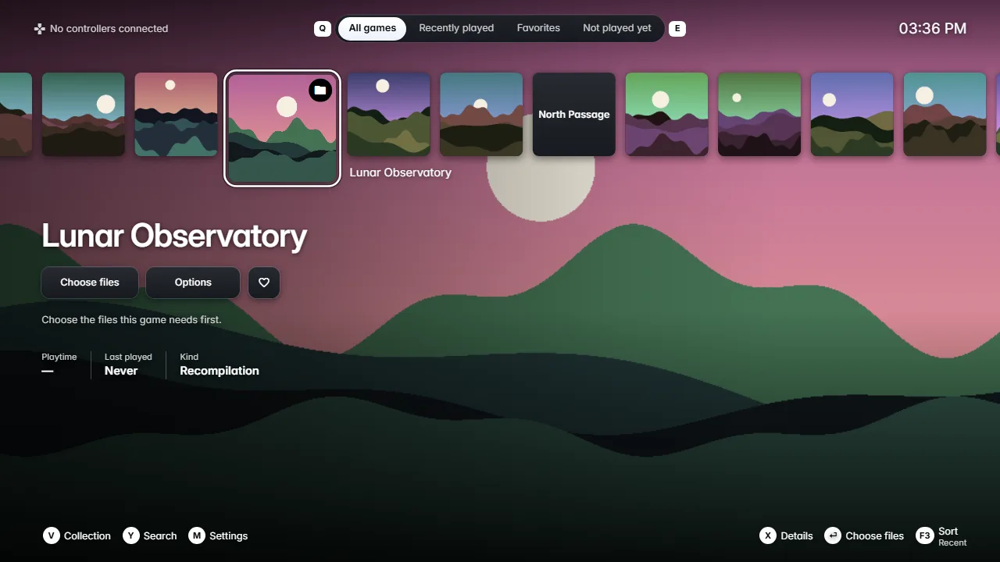
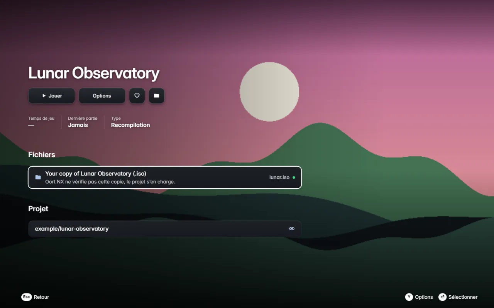
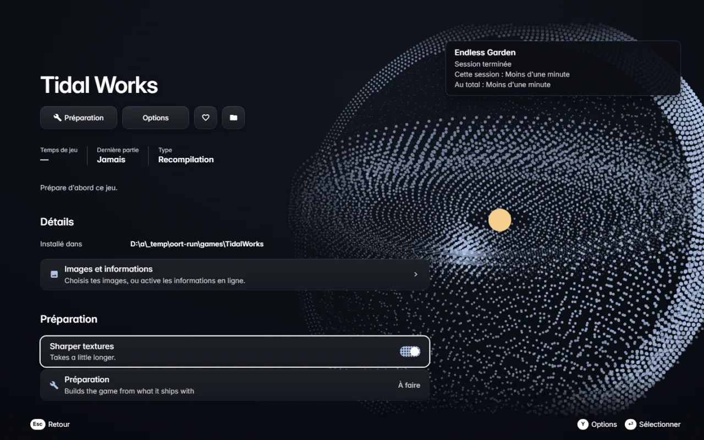

## Choose the folder
<!-- step folder checked f18e2119:desktop/ui/app.js f18e2119:Sources/OortCompanion/Manifest.swift -->
**+** tile › **A folder of games**. Each game there is a folder with its `recomplauncher.json` file.

## See what is missing
<!-- step needs checked f18e2119:desktop/ui/app.js f18e2119:desktop/tests/walk.js -->
If a game asks for files, its button becomes **Choose files**.

## Give your copy
<!-- step files checked f18e2119:Sources/OortCompanion/Companion.swift f18e2119:desktop/tests/play.js -->
On its page, choose your own file. Oort only remembers where it is, without copying it.

## Get it ready if needed
<!-- step prepare checked f18e2119:desktop/ui/app.js f18e2119:desktop/tests/play.js -->
**Get ready** runs the step the project planned. If it needs files copied or downloaded, do it in the project itself.

