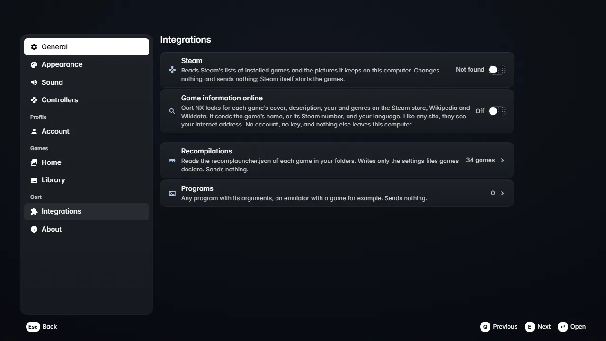

## Not in this version
<!-- step not-yet code cc9db84a:desktop/README.md cc9db84a:desktop/ui/app.js -->
Alpha.1 does not read your Steam library. You can add a game’s program by hand, but Oort does not go through Steam; that way was not tried.

